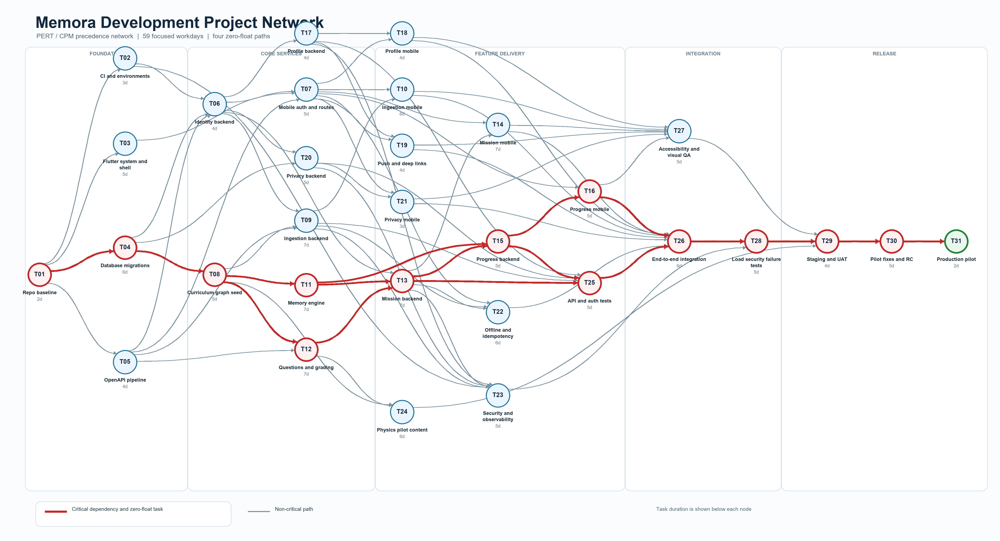
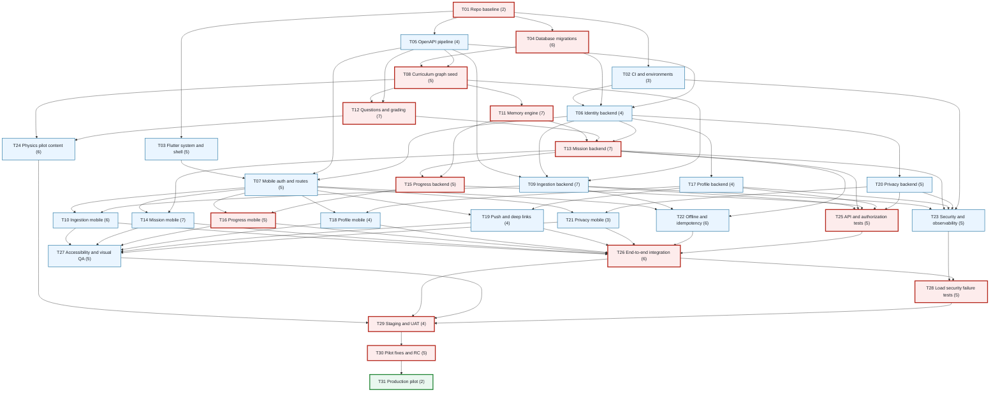

# Memora Development Network Plan

**Status:** Initial CPM execution baseline  
**Prepared:** 22 October 2026  
**Planning unit:** Focused engineering workdays  
**Ownership model:** Developer independent task claiming  
**Scope:** Student-facing Flutter and FastAPI MVP through production pilot

Detailed execution contracts and tracking fields are in `./Memora_Development_Task_Table.md`.

## 1 How this plan works

This is a precedence network, not a fixed staffing plan. A developer claims any task whose dependencies are complete. Several ready tasks may run in parallel. The team moves forward by merging completed tasks, not by assigning permanent feature ownership.

The estimates describe task effort and provide a CPM baseline. The calculated 59-workday duration assumes unlimited parallel capacity, one focused developer per active task, immediate review, and no unavailable external dependency. Actual calendar duration changes when the team is resource constrained. Recalculate the network after estimates or dependencies change.

### Operating rule

1. Mark a task **Ready** only when every predecessor is merged and its acceptance inputs exist.
2. A developer claims one Ready task and creates `task/Txx-short-name`.
3. Keep one task and one acceptance boundary per pull request.
4. Merge only after tests, required documentation, generated contracts and CI pass.
5. Mark the task **Done**, then expose its successors whose remaining predecessors are Done.
6. Prefer critical tasks when several tasks are Ready. Next prefer tasks with the lowest float.

## 2 Network legend

| Marking | Meaning |
| --- | --- |
| Red node | Zero-float critical task |
| Blue node | Non-critical implementation task |
| Green node | Release milestone |
| Number in parentheses | Estimated focused workdays |
| Arrow | Finish-to-start dependency |

## 3 Complete development network

The PNG is the presentation view. The Mermaid graph below remains the editable dependency source.

## 4 Critical paths

Four equal zero-float paths produce the 59-workday CPM duration:

1. `T01 -> T04 -> T08 -> T11 -> T13 -> T15 -> T16 -> T26 -> T28 -> T29 -> T30 -> T31`
2. `T01 -> T04 -> T08 -> T12 -> T13 -> T15 -> T16 -> T26 -> T28 -> T29 -> T30 -> T31`
3. `T01 -> T04 -> T08 -> T11 -> T13 -> T15 -> T25 -> T26 -> T28 -> T29 -> T30 -> T31`
4. `T01 -> T04 -> T08 -> T12 -> T13 -> T15 -> T25 -> T26 -> T28 -> T29 -> T30 -> T31`

`T11` and `T12` are parallel critical branches; both must finish before `T13`. `T16` and `T25` are also parallel critical branches; both must finish before `T26`. A delay on any of these branches delays the current baseline unless another task is shortened.

## 5 CPM task table

Day zero is the start of `T01`. ES is earliest start, EF earliest finish, LS latest start, LF latest finish, and Float is available delay without moving the pilot launch.

| ID | Task | Days | Dependencies | ES | EF | LS | LF | Float |
| --- | --- | ---: | --- | ---: | ---: | ---: | ---: | ---: |
| T01 | Architecture baseline and repository scaffold | 2 | None | 0 | 2 | 0 | 2 | **0** |
| T02 | CI and development environments | 3 | T01 | 2 | 5 | 13 | 16 | 11 |
| T03 | Flutter design system and app shell | 5 | T01 | 2 | 7 | 20 | 25 | 18 |
| T04 | PostgreSQL migrations and seed framework | 6 | T01 | 2 | 8 | 2 | 8 | **0** |
| T05 | OpenAPI models and generated client pipeline | 4 | T01 | 2 | 6 | 9 | 13 | 7 |
| T06 | Identity and session backend | 4 | T02, T04, T05 | 8 | 12 | 16 | 20 | 8 |
| T07 | Auth bootstrap mobile and guarded routes | 5 | T03, T05, T06 | 12 | 17 | 25 | 30 | 13 |
| T08 | Curriculum and knowledge graph seed | 5 | T04, T05 | 8 | 13 | 8 | 13 | **0** |
| T09 | Learning ingestion backend | 7 | T05, T06, T08 | 13 | 20 | 24 | 31 | 11 |
| T10 | Learning ingestion mobile | 6 | T07, T09 | 20 | 26 | 31 | 37 | 11 |
| T11 | Memory engine v1 | 7 | T08 | 13 | 20 | 13 | 20 | **0** |
| T12 | Question bank and grading backend | 7 | T08, T05 | 13 | 20 | 13 | 20 | **0** |
| T13 | Mission assembly and completion backend | 7 | T06, T11, T12 | 20 | 27 | 20 | 27 | **0** |
| T14 | Mission mobile experience | 7 | T07, T13 | 27 | 34 | 30 | 37 | 3 |
| T15 | Progress XP streak and reef backend | 5 | T11, T13 | 27 | 32 | 27 | 32 | **0** |
| T16 | Progress mobile experience | 5 | T07, T15 | 32 | 37 | 32 | 37 | **0** |
| T17 | Profile preferences and notifications backend | 4 | T06 | 12 | 16 | 28 | 32 | 16 |
| T18 | Profile and settings mobile | 4 | T07, T17 | 17 | 21 | 33 | 37 | 16 |
| T19 | Push notifications and deep links | 4 | T07, T17 | 17 | 21 | 33 | 37 | 16 |
| T20 | Privacy export and deletion backend | 5 | T06, T04 | 12 | 17 | 27 | 32 | 15 |
| T21 | Privacy mobile experience | 3 | T07, T20 | 17 | 20 | 34 | 37 | 17 |
| T22 | Offline sync and idempotency hardening | 6 | T09, T13, T07 | 27 | 33 | 31 | 37 | 4 |
| T23 | Observability and security hardening | 5 | T02, T09, T13, T17, T20 | 27 | 32 | 38 | 43 | 11 |
| T24 | Verified Physics pilot content | 6 | T08, T12 | 20 | 26 | 42 | 48 | 22 |
| T25 | API contract and authorization tests | 5 | T09, T13, T15, T17, T20 | 32 | 37 | 32 | 37 | **0** |
| T26 | Cross-feature end-to-end integration | 6 | T10, T14, T16, T18, T19, T21, T22, T25 | 37 | 43 | 37 | 43 | **0** |
| T27 | Accessibility and visual QA | 5 | T10, T14, T16, T18, T19, T21 | 37 | 42 | 43 | 48 | 6 |
| T28 | Load security and failure testing | 5 | T23, T26 | 43 | 48 | 43 | 48 | **0** |
| T29 | Staging release and UAT | 4 | T24, T26, T27, T28 | 48 | 52 | 48 | 52 | **0** |
| T30 | Pilot fixes and release candidate | 5 | T29 | 52 | 57 | 52 | 57 | **0** |
| T31 | Production pilot launch | 2 | T30 | 57 | 59 | 57 | 59 | **0** |

## 6 Parallel work windows

| Window | Critical work | Parallel work that can also proceed |
| --- | --- | --- |
| After T01 | T04 | T02, T03 and T05 |
| After T04 and T05 | T08 | T06 after its other inputs |
| After T08 | T11 and T12 in parallel | T09 when T06 is ready |
| After T13 | T15 | T14, T22 and T23 |
| After T15 | T16 and T25 in parallel | Profile, privacy, notifications and content branches |
| Before T26 | Finish both critical branches | T10, T14, T18, T19, T21 and T22 must also converge |
| After T26 | T28 | T27 and remaining pilot content |
| Release | T29 then T30 then T31 | No parallel task may bypass a release gate |

## 7 Task completion contracts

| Task group | Required output before Done |
| --- | --- |
| Foundation T01-T08 | Repository conventions, CI, migrations, generated contracts, auth and reviewed seed structure |
| Learning T09-T12 | Secure ingestion, verified candidates, memory policy and graded question paths with tests |
| Mission T13-T16 | Idempotent mission lifecycle and matching mobile states, including progress projections |
| Account T17-T21 | Preferences, push/deep links, privacy workflows and mobile recovery states |
| Hardening T22-T25 | Offline reconciliation, observability, security, pilot content and authorization contracts |
| Integration T26-T28 | Required end-to-end scenario, accessibility checks and failure/load/security evidence |
| Release T29-T31 | Staging approval, resolved pilot blockers, signed release artifacts and monitored launch |

A task is Done only when its acceptance tests pass, relevant specification links are preserved, migrations or generated files are included, no sensitive data enters logs, and the pull request is merged. Partial work remains In Progress and does not unblock successors.

## 8 Merge and conflict rules

- Shared contracts change through their own task or a coordinated prerequisite pull request.
- Backend work begins from the reviewed OpenAPI and schema contract; mobile work consumes generated DTOs rather than hand-written duplicates.
- Feature branches do not edit unrelated shared tokens, global navigation or migrations.
- Migrations are forward-only, uniquely ordered and tested from an empty database and the previous merged state.
- A developer who needs an unfinished predecessor uses a mock or feature flag only inside the current task; the task cannot be Done until integrated with the real predecessor.
- Rebase or update from the integration branch before final review, rerun tests, then squash or merge according to repository policy.
- A failed integration test reopens the earliest task whose output violates its completion contract.

## 9 Ready queue protocol

Use these board states: **Blocked**, **Ready**, **In Progress**, **Review**, **Done**.

The initial Ready queue contains only `T01`. After it is Done, `T02`, `T03`, `T04` and `T05` become Ready together. The project coordinator or automation recalculates successors after every merge.

When several tasks are Ready, select in this order:

1. Zero float.
2. Lowest positive float.
3. Task that unblocks the most successors.
4. Best fit for the currently available developer.

Do not start a blocked critical task by silently assuming its predecessor contract. Resolve or split the dependency explicitly and recalculate the network.

## 10 Change control and recalculation

Recalculate CPM when a task estimate changes, a dependency is added or removed, scope moves into or out of the MVP, or resource limits prevent planned parallelism. Preserve task IDs after work begins. New tasks receive new IDs; removed tasks are marked Cancelled rather than renumbering the network.

The baseline is accepted when the team reviews estimates, confirms the pilot release gates, and records any external dependencies such as identity-provider approval, cloud accounts, legal review and verified Physics content availability.

