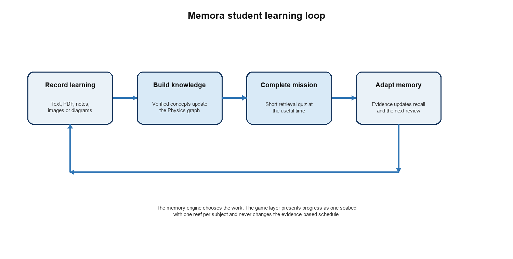

<!-- Text equivalent of Memora_PRD.docx. Keep the DOCX and Markdown versions synchronized. -->

# Memora Product Requirements Document

**Student first MVP for Sri Lankan GCE Advanced Level Physics**

Version 1.0

Prepared 22 October 2026

This document defines the product problem, users, outcomes, scope, user journeys, functional requirements and release criteria for the first Memora build. The MVP serves Sri Lankan GCE Advanced Level students studying Physics and proves the complete learn, retrieve, adapt and return loop before classroom features or additional subjects are added.

Product owner: Memora

Primary readers: product, design, engineering, academic content and security teams

## Executive summary

Memora helps students retain what they learn by scheduling short retrieval activities before memories become difficult to recall. Students add material after lectures or study sessions. Memora extracts and verifies concepts, adds them to a Physics knowledge graph, tests the student through short Daily Missions and uses the answers to update the next review time.

The first build focuses on Sri Lankan GCE Advanced Level Physics because the subject combines theory, mathematical problem solving, formulas, diagrams and linked prerequisites. This scope tests the core product more thoroughly than a fact-only subject while keeping academic content within one curriculum boundary.

The MVP is student-first. It includes personal learning updates, temporary document ingestion, the adaptive memory loop, verified and grounded questions, progress explanations and the Mora seabed experience. Teacher classrooms, multi-subject support, public competition and institution administration are outside the MVP.

### Confirmed product decisions

| **Area** | **Decision** |
| --- | --- |
| First market | Students following the Sri Lankan GCE Advanced Level curriculum |
| First subject | Physics, covering both theory and mathematical problem solving |
| MVP user | Individual student; teacher and classroom workflows follow after the student loop is proven |
| Core intervention | Short adaptive retrieval quizzes scheduled from learning evidence |
| Learning input | Text plus temporary PDF, note-photo, image and diagram uploads |
| Retained knowledge | Structured concepts, relationships and learner evidence; original uploads are deleted after validated ingestion |
| Engagement | Daily Missions and one continuous seabed with one reef per subject |
| Competition | Personal progress only; no public rankings in the MVP |
| Question trust | Verified human-authored questions take priority over grounded AI-generated questions |

*Figure 1  The MVP student learning loop*

## 1 Product problem

### 1.1 Current pain

Advanced Level students accumulate new material across frequent lectures, tuition classes and independent study. Revision is usually driven by the next examination, a teacher reminder or the student's own judgement. Students therefore spend time revising familiar material while weak concepts and prerequisites remain undiscovered until a test.

Physics makes this problem harder because success depends on connected knowledge. A student may remember a formula but forget the conditions under which it applies, confuse related quantities, misread a diagram or fail because an earlier mathematical or conceptual prerequisite is weak. A simple reminder or static flashcard deck does not model these relationships.

### 1.2 Product response

Memora maintains a current model of what the student has learned and how retrievable each concept is likely to be. It converts lecture updates into structured knowledge, uses short quizzes as evidence and schedules the next useful retrieval activity. The product reduces planning effort for the student while preserving transparent explanations and a manageable daily workload.

### 1.3 Product promise

A student should be able to record what was learned, leave the planning to Memora and return for a short Daily Mission that focuses on the memories most worth protecting or repairing.

## 2 Target users

### 2.1 Primary user

| **Attribute** | **MVP definition** |
| --- | --- |
| User | A student studying Sri Lankan GCE Advanced Level Physics |
| Context | School, tuition classes and independent study produce frequent overlapping learning updates |
| Need | Know what to revise, when to revise it and which prerequisite caused a mistake |
| Constraint | Limited time, variable motivation, examination pressure and mixed-quality notes |
| Device | A personal Android or iOS phone, sometimes with unreliable connectivity |
| Trust expectation | Correct academic content, private learning data and a clear reason for each review |

### 2.2 Secondary users after the MVP

- Physics teachers and tuition teachers who create classrooms, contribute questions and monitor authorized student memory trends.
- Academic reviewers who maintain verified question banks and resolve disputed questions.
- Platform administrators who manage access, content quality, billing, safety and audit records.
These roles influence the long-term architecture but do not add workflows to the student-first MVP.

## 3 Goals and success measures

### 3.1 Product goals

**1. **Prove that a student can complete the full learning-update, quiz, evidence and rescheduling loop without manual flashcard creation.

**2. **Improve delayed recall of A/L Physics concepts while keeping the normal Daily Mission between three and seven minutes.

**3. **Make the next action obvious enough that a student can return daily without planning a revision timetable.

**4. **Earn trust through verified questions, grounded explanations, transparent scheduling and secure handling of learning material.

**5. **Create a reusable subject model that can later support other A/L subjects and teacher classrooms without redesigning the core loop.

### 3.2 Proposed pilot measures

These are initial product targets for a controlled pilot. The team should revise them after baseline data is available.

| **Measure** | **Initial target** | **Reason** |
| --- | --- | --- |
| Activation | At least 65% of registered pilot students add learning material and complete the first retrieval within 48 hours | Confirms that onboarding reaches the core value |
| Daily Mission completion | At least 60% of issued missions are completed by weekly active students | Tests whether the workload and return hook are realistic |
| Mission duration | Median completed mission remains between 3 and 7 minutes | Protects the promise of manageable daily revision |
| Four week useful return | At least 35% of activated pilot students complete a mission in week four | Measures continued use based on learning work rather than app opens |
| Delayed recall | Pilot recall improves by at least 10 percentage points against the agreed baseline or comparison method | Tests the learning outcome directly |
| Recall calibration | Observed recall remains within 10 percentage points of predicted recall in sufficiently sized probability bands | Checks whether scheduling evidence is credible |
| Question trust | Verified-question dispute rate stays below 1%; grounded AI-question dispute rate stays below 3% | Protects academic accuracy |
| Critical trust events | Zero unresolved critical academic, privacy or authorization incidents at release | Defines a non-negotiable launch condition |

### 3.3 Guardrail measures

- Do not improve return rate by extending missions beyond the workload cap.
- Do not award meaningful XP for opening the app, repeated uploads or other actions that do not produce learning evidence.
- Track notification opt-out, question reports, abandoned quizzes and comeback completion alongside engagement.
- Report learning metrics separately for verified and AI-generated questions so lower-quality content cannot hide inside aggregate results.
## 4 Product scope

### 4.1 Included in the MVP

| **Capability** | **MVP scope** |
| --- | --- |
| Account | Register, sign in, manage sessions, recover access, export data and delete the account |
| Subject | One launch subject: Sri Lankan GCE Advanced Level Physics |
| Learning updates | Add text and temporarily upload supported PDFs, note photos, images and diagrams after lectures or study |
| Knowledge ingestion | Extract concepts and relationships, flag uncertainty, let the student verify when needed and delete source uploads after commit |
| Memory | Maintain concept-level state and schedule retrieval from evidence, elapsed time, difficulty and prerequisite relationships |
| Questions | Use verified Physics questions first and grounded AI generation only when coverage is missing |
| Quiz | Short Daily Missions with objective, numeric and bounded short-answer formats |
| Feedback | Explain the answer, identify misconceptions and show why another review was scheduled |
| Game experience | Mora, XP, one weekly streak grace day, permanent cosmetics and a Physics reef whose health reflects current retention |
| Notifications | Actionable review reminders with quiet hours and frequency controls |
| Progress | Personal retention, due work, protected or repaired memories, reef state and next useful action |
| Trust | Question reporting, grading appeal, provenance, privacy controls and security-relevant audit events |

### 4.2 Excluded from the MVP

- Teacher accounts, classrooms, assignments and classroom analytics.
- Subjects other than Sri Lankan GCE Advanced Level Physics.
- Public profiles, leaderboards, social feeds, direct messaging and public content sharing.
- Live tuition, video conferencing, institution administration and parent dashboards.
- Open-ended general tutoring chat or an unrestricted chatbot.
- A question marketplace, public creator economy or automated promotion of private notes into shared content.
- Paid academic advantages, loot boxes, blocking lives or purchases that change memory scheduling.
### 4.3 Scope change rule

A capability enters the MVP only when it is required to complete, trust, measure or safely operate the student learning loop. New roles, subjects and engagement mechanics require an explicit PRD revision before implementation.

## 5 Product principles

| **Principle** | **Product consequence** |
| --- | --- |
| Retrieval before rereading | Questions and recall activities are the default intervention |
| Evidence before appearance | The memory state controls reef health; the game layer cannot invent progress |
| Verified content first | Human-approved questions take precedence wherever curriculum coverage exists |
| Concept-level personalization | Different Physics concepts can have different memory states and review dates |
| Explain every consequence | Students can see why a concept appeared and why its next review changed |
| Private by default | Personal material and learner evidence are not shared without an explicit future workflow |
| Bounded daily work | The product prioritizes within a workload cap instead of creating an endless queue |
| Recovery without punishment | Missed work creates a manageable comeback mission; permanent rewards are never removed |
| Accessibility from the start | Health, correctness and navigation are not communicated by colour alone |

## 6 Core user journey

**1. **The student creates an account and selects Sri Lankan GCE Advanced Level Physics.

**2. **The student records what was learned in a lecture or study session using text or a supported temporary upload.

**3. **Memora extracts concepts, formulas, conditions, relationships, examples and possible misconceptions.

**4. **The student verifies uncertain extraction when the system cannot safely resolve the material.

**5. **Memora commits the validated knowledge update and deletes the original upload and temporary derivatives.

**6. **The memory engine schedules the first retrieval opportunity and combines it with any older due work.

**7. **The Home screen presents Today's Mission with due memories, estimated time and the reward for completion.

**8. **The student answers a short sequence of verified or grounded questions.

**9. **Memora grades each answer, explains the result and records structured learning evidence.

**10. **The memory engine updates recall estimates, schedules the next review and identifies repair or prerequisite work.

**11. **The Physics reef responds to the new retention state while XP and earned decorations remain permanent.

**12. **The student can inspect progress, report a problem or leave after completing the bounded mission.

## 7 User stories

| **ID** | **User story** | **Priority** |
| --- | --- | --- |
| US 01 | As an A/L Physics student, I want to record what I learned after each class so that Memora can include it in future revision. | Must |
| US 02 | As a student, I want to upload a PDF or photo without permanently storing the file so that I can use my notes without creating a privacy and storage burden. | Must |
| US 03 | As a student, I want to verify uncertain extraction so that incorrect knowledge is not silently added to my subject. | Must |
| US 04 | As a student, I want Memora to merge repeated lecture content so that duplicate concepts do not create duplicate revision. | Must |
| US 05 | As a student, I want one short Daily Mission so that I know exactly what to revise today. | Must |
| US 06 | As a student, I want questions chosen from the concepts I am likely to forget so that my effort is spent where it matters. | Must |
| US 07 | As a student, I want official or expert-reviewed questions to be preferred so that I can trust the material. | Must |
| US 08 | As a student, I want explanations after each answer so that a mistake becomes useful learning evidence. | Must |
| US 09 | As a student, I want to know why the next review was selected so that personalization does not feel arbitrary. | Must |
| US 10 | As a student, I want weak prerequisites identified so that I can repair the cause of repeated mistakes. | Must |
| US 11 | As a student, I want my Physics reef to reflect retention so that progress is understandable at a glance. | Should |
| US 12 | As a returning student, I want a manageable comeback mission so that missed reviews do not make the app feel impossible to resume. | Must |
| US 13 | As a student, I want permanent XP and cosmetic rewards so that temporary forgetting does not erase earned progress. | Should |
| US 14 | As a student, I want to report an incorrect question or appeal uncertain grading so that poor evidence does not damage my schedule. | Must |
| US 15 | As a student, I want notification controls and quiet hours so that Memora supports revision without becoming intrusive. | Must |
| US 16 | As a student, I want to export or delete my information so that I remain in control of my account and learning data. | Must |

## 8 Functional requirements

### 8.1 Account and onboarding

| **ID** | **Requirement** | **Acceptance condition** |
| --- | --- | --- |
| PRD 001 | The student can register, sign in, sign out, recover access and revoke active sessions. | Each action has a clear success, error and recovery state. |
| PRD 002 | Onboarding explains the learning loop, temporary upload handling, Daily Missions and reef meaning. | The student can reach the first learning update without passing through unrelated features. |
| PRD 003 | The MVP creates one Physics subject aligned to the selected Sri Lankan GCE A/L curriculum version. | The curriculum identifier is visible in subject settings and stored with content mappings. |
| PRD 004 | The student can set notification permission, quiet hours and preferred reminder window. | The app works when notifications are denied and explains how to change the choice later. |

### 8.2 Learning updates and ingestion

| **ID** | **Requirement** | **Acceptance condition** |
| --- | --- | --- |
| PRD 005 | The student can add several learning updates on the same day without overwriting earlier updates. | Every accepted update has its own time, provenance and processing status. |
| PRD 006 | The app accepts manual text and a defined set of PDF and image formats within published size limits. | Unsupported type, size or quality produces a specific error before processing. |
| PRD 007 | Uploads remain temporary and are deleted after a validated knowledge commit or the configured failure window. | The student can see whether processing, verification or deletion is pending. |
| PRD 008 | Extraction identifies Physics concepts, formulas, variables, conditions, units, diagrams, examples and relationships. | The output conforms to the allowed knowledge schema and retains confidence and provenance. |
| PRD 009 | Low-confidence handwriting, diagram or formula extraction requires student verification before commit. | No uncertain item is presented as verified knowledge without confirmation. |
| PRD 010 | The product merges equivalent concepts and preserves meaningful differences. | Repeated material does not create duplicate review obligations, and conflicting claims are flagged. |

### 8.3 Memory and Daily Missions

| **ID** | **Requirement** | **Acceptance condition** |
| --- | --- | --- |
| PRD 011 | Each student-concept pair has an independent memory state and next-review decision. | Updating one concept does not incorrectly overwrite unrelated concepts. |
| PRD 012 | The system schedules the first retrieval near the next day unless evidence or policy justifies another time. | The decision records the input evidence and explanation. |
| PRD 013 | Today's Mission prioritizes due, near-threshold, recently forgotten and weak prerequisite concepts within the workload cap. | The mission has a bounded item count and estimated duration before it begins. |
| PRD 014 | Mission types include Protect, Repair, Recover, Discover and Challenge. | Every mission item has one recorded type and learning purpose. |
| PRD 015 | A missed review uses actual elapsed time and produces a manageable comeback plan. | The product does not erase progress, multiply work without a cap or shame the student. |
| PRD 016 | The student can see why a concept was selected and why its next review changed. | The explanation refers to evidence, timing or prerequisite state rather than an unsupported AI claim. |

### 8.4 Questions and answer feedback

| **ID** | **Requirement** | **Acceptance condition** |
| --- | --- | --- |
| PRD 017 | Verified expert-authored questions are selected before teacher-authored or AI-generated alternatives. | The question displays a trust label and source class. |
| PRD 018 | The MVP supports MCQ, numeric response and bounded short answer. | Each format has deterministic or rubric-based grading and an accessible input state. |
| PRD 019 | Generated questions must be grounded in authorized graph evidence and pass automated validation. | Unsupported generation is rejected rather than shown to the student. |
| PRD 020 | Feedback distinguishes correctness, partial correctness, misconception and grading confidence. | Low-confidence grading has limited influence and offers confirmation or appeal. |
| PRD 021 | The student can report a question, explanation or knowledge error. | Reported material is traceable, can be excluded from high-impact updates and has a visible submission result. |
| PRD 022 | Timing is optional unless response speed is part of the assessed skill. | The default quiz does not present a countdown timer. |

### 8.5 Progress and game experience

| **ID** | **Requirement** | **Acceptance condition** |
| --- | --- | --- |
| PRD 023 | Home presents Today's Mission as the dominant action with due memories, estimated duration and reward. | The student can begin in one action and is not sent into an endless activity feed. |
| PRD 024 | The Progress screen shows one continuous seabed with one Physics reef in the MVP and room for future subject reefs. | The world does not imply separate disconnected maps for each subject. |
| PRD 025 | Reef health is derived from current recall, overdue work, prerequisite risk and recent evidence. | The displayed state can be recomputed from the recorded product state. |
| PRD 026 | Thriving, Healthy, Needs Care, Stressed and Dormant states are distinguishable without colour alone. | State variants differ through activity, density, lighting and clarity and pass accessibility review. |
| PRD 027 | Incorrect answers highlight weak areas and create repair work without damaging the whole reef immediately. | A single mistake cannot move the whole subject directly to a punitive state. |
| PRD 028 | XP rewards meaningful scheduled learning and is applied once per eligible event. | Opening the app or repeating an upload cannot farm XP. |
| PRD 029 | Earned decorations and Mora cosmetics are permanent and provide no academic advantage. | Declining retention cannot remove an owned reward or change scheduling priority. |
| PRD 030 | The weekly streak has one grace day and supports a welcoming return after absence. | A missed day within the rule does not reset the streak and no absence removes permanent progress. |

### 8.6 Notifications privacy and account control

| **ID** | **Requirement** | **Acceptance condition** |
| --- | --- | --- |
| PRD 031 | Notifications name the subject and useful action without exposing sensitive learning detail on the lock screen by default. | The user can choose preview detail and disable categories. |
| PRD 032 | Quiet hours, frequency caps and reminder preferences apply across all mission notifications. | No reminder is issued during quiet hours except a user-configured exception. |
| PRD 033 | Students can inspect retained data categories and the status of temporary uploads. | The product separates source-file status from retained knowledge and learning evidence. |
| PRD 034 | Students can export and delete their account through a verified workflow. | Deletion covers private knowledge and learner evidence subject to clearly stated security and legal retention. |
| PRD 035 | The app records consent and policy version for material processing and model-provider use. | A policy change requiring renewed consent blocks only the affected operation and explains the reason. |

## 9 Content requirements for A Level Physics

### 9.1 Curriculum boundary

Every shared concept and verified question must map to the selected official Sri Lankan GCE Advanced Level Physics curriculum version. The exact syllabus edition, language medium and examination-year applicability remain launch configuration decisions and must be recorded before content production begins.

### 9.2 Knowledge representation

- Represent definitions, laws, principles, formulas, variables, SI units, conditions, diagrams, worked methods and common misconceptions as typed knowledge.
- Represent prerequisites and dependencies so that a weak mathematical or conceptual foundation can trigger a Recover Mission.
- Keep symbol meaning and unit context attached to formulas; the same letter must not be assumed to mean the same quantity everywhere.
- Preserve alternative valid solution methods while distinguishing them from contradictory or out-of-syllabus material.
### 9.3 Verified question bank

| **Requirement** | **MVP rule** |
| --- | --- |
| Authorship | Questions are written or reviewed by qualified A/L Physics teachers or subject experts |
| Mapping | Every question maps to curriculum objectives and one or more knowledge-graph concepts |
| Answer support | Each item has an official key or rubric, reasoning and any required constants or diagram |
| Versioning | Academic edits create a new version and preserve the attempt's original version |
| Coverage | Content reporting distinguishes verified coverage gaps from generated fallback coverage |
| Disputes | Reported or ambiguous questions can be removed from high-impact memory updates while reviewed |

## 10 Experience requirements

### 10.1 Visual identity

The Flutter application follows the approved Figma direction: pale blue rounded surfaces, cyan gradients, dark navy text, bright blue icons and the Mora shark character. The Figma design system is the source of truth for exact fonts, tokens, component dimensions, responsive constraints and motion.

### 10.2 Quiz interaction

- Hide bottom navigation during an active question sequence.
- Keep the selected answer, submission action and progress indicator visually distinct.
- Present incorrect answers as useful evidence and show the next repair action without a large punitive red state.
- End the mission with memories protected or repaired, XP earned, streak status, reef response and the next scheduled action.
### 10.3 Accessibility

- Meet WCAG 2.2 AA contrast and interaction requirements where applicable to the mobile experience.
- Provide screen-reader labels, logical focus order, scalable text and touch targets suitable for mobile use.
- Do not communicate correctness, reef health, due status or trust level through colour alone.
- Respect reduced-motion settings and offer non-animated equivalents for meaningful state changes.
### 10.4 Connectivity

The app should tolerate brief connection loss, preserve unsent student input safely and explain which actions require a connection. Quiz answers must not be silently duplicated or lost during retries. Fully offline knowledge ingestion and scheduling are not required for the MVP.

## 11 Trust privacy and safety requirements

| **Area** | **Product requirement** |
| --- | --- |
| Academic accuracy | Verified content is preferred, generated content is labelled and unsupported output is withheld |
| Upload handling | The app clearly states that source files are temporary and shows verification or failure states before deletion |
| Private learning | Personal notes, knowledge and evidence are private to the student in the MVP |
| Model providers | Only the minimum required content is sent through approved model routes under recorded policy |
| Prompt injection | Uploaded content is treated as learning data and cannot grant instructions or access |
| Young users | The final age range, consent model and Sri Lankan legal requirements must be reviewed before public release |
| Emotional safety | The game avoids shame, destruction, loss of earned rewards and pressure to continue indefinitely |
| Corrections | Students have a clear path to report academic errors and challenge uncertain grading |
| Transparency | Trust label, schedule reason and relevant data use are visible at the point where they matter |

## 12 Release criteria

### 12.1 Required end to end scenario

**1. **A new student completes onboarding and adds two Physics learning updates on the same day.

**2. **One update is manual text and the other is a supported temporary image or PDF upload.

**3. **Memora extracts overlapping concepts, requests verification for one uncertain item and commits the validated graph update without duplication.

**4. **The source upload and temporary derivatives are deleted after the verified commit.

**5. **The student receives a Daily Mission that mixes new material with an older weak prerequisite.

**6. **A verified objective question is graded deterministically and a bounded short answer is graded with a stored rubric and confidence.

**7. **An incorrect answer creates a Repair or Recover action without over-penalizing uncertain evidence.

**8. **The memory decision records recall estimate, policy rules, graph relationships, next review and a user-facing reason.

**9. **The Physics reef changes from the new memory state while permanent XP and decorations remain intact.

**10. **The student reports one questionable item, changes quiet hours and successfully exports or deletes the account in the test environment.

### 12.2 Launch gates

| **Gate** | **Pass condition** |
| --- | --- |
| Product | All Must user stories and PRD requirements pass their acceptance conditions |
| Academic | The approved Physics curriculum map and minimum verified-question coverage are signed off by the content owner |
| Memory | Scheduling simulations and pilot calibration meet the agreed safe bounds |
| Security | Threat review, authorization tests, upload controls and deletion verification have no unresolved critical finding |
| Privacy | Data inventory, consent text, provider policy, export and deletion workflows are approved |
| Accessibility | Core onboarding, update, mission, feedback and progress flows pass the accessibility review |
| Reliability | The team can restore data, retry jobs without duplication and operate through a model-provider failure |
| Measurement | Activation, mission, learning, dispute, cost and trust events are measurable before pilot enrolment |

## 13 Risks and product mitigations

| **Risk** | **Product impact** | **Mitigation** |
| --- | --- | --- |
| Incorrect extraction followed by deletion | The student's retained knowledge may be wrong and the original may be unavailable | Require confidence gates, targeted verification, provenance and a clear re-upload path |
| Incorrect generated question | The student may learn false Physics content | Prefer verified coverage, require graph support, label source, validate answers and support reporting |
| Poor grading changes scheduling | The memory model may reinforce a false weakness | Store confidence, limit low-confidence influence and offer confirmation or appeal |
| Backlog grows after absence | The student avoids returning | Cap workload, prioritize useful concepts and create a welcoming comeback mission |
| Game rewards replace learning goals | Students optimize XP instead of retention | Reward scheduled evidence, prevent farming and keep the memory engine independent |
| Reef states feel punitive | At-risk students disengage | Use reversible states, gradual change, supportive copy and permanent earned rewards |
| Physics scope expands informally | Content becomes inconsistent and unreviewable | Require curriculum mapping and PRD approval for out-of-scope content |
| Language coverage is unclear | Students receive terminology that does not match their study medium | Choose the initial language medium before authoring and version translations separately |
| Costs exceed student pricing | The product cannot sustain routine use | Measure cost per active learner, prioritize verified reuse and cap expensive model operations |

## 14 Open product decisions

| **Decision** | **Why it must be resolved** | **Recommended next action** |
| --- | --- | --- |
| Official syllabus edition | Controls every concept and question mapping | Select the exact curriculum version before building the content graph |
| Initial language medium | Controls terminology, OCR evaluation and question authoring | Choose English, Sinhala or Tamil for the pilot; add separate translation review later |
| Pilot cohort | Controls onboarding, consent, support and measurement | Recruit a bounded group with a defined study stage and consent process |
| Minimum verified coverage | Determines where AI fallback is acceptable | Set required coverage by curriculum unit before pilot launch |
| Target retention level | Controls review frequency and workload | Choose an initial default and test it against the 3 to 7 minute mission target |
| Free and paid boundary | Affects trust, acquisition and model cost | Run the first controlled pilot without paid academic advantages; define entitlements after usage data |
| Age and consent policy | Some A/L students may be minors | Complete legal and privacy review for Sri Lanka before public registration |

## 15 Product roadmap boundary

| **Stage** | **Product scope** | **Evidence required to proceed** |
| --- | --- | --- |
| Pilot MVP | Individual A/L Physics student loop, temporary ingestion, adaptive missions, verified-first questions and Physics reef | End-to-end release gates pass and pilot instrumentation is ready |
| Student version 1 | Refined memory calibration, wider verified coverage, subscriptions and production support | Pilot shows credible learning, trust, engagement and cost results |
| Teacher version | Classrooms, teacher questions, assignments and authorized memory analytics | Student loop is stable and teacher discovery validates the workflow |
| Subject expansion | Additional A/L subjects, each represented as a reef on the same seabed | A repeatable ontology, review and question-bank process exists |
| Institution version | Administration, deployment and reporting for schools or tuition organizations | Teacher version proves demand, privacy boundaries and support capacity |

## 16 Product terminology

| **Term** | **Definition** |
| --- | --- |
| Learning update | A record of what the student learned during a lecture or study session |
| Memory item | A concept, relationship, formula or misconception that can receive retrieval evidence |
| Daily Mission | The bounded set of useful retrieval activities selected for the student today |
| Protect Mission | Review of a concept that is due or approaching its recall threshold |
| Repair Mission | Focused work created after forgetting or misconception evidence |
| Recover Mission | Review of a weak prerequisite needed for a current concept |
| Discover Mission | The first retrieval work associated with newly added learning |
| Challenge Mission | A mixed checkpoint that tests transfer across related concepts |
| Reef health | A reversible presentation of current subject retention, overdue work and prerequisite risk |
| Permanent progression | XP, decorations and cosmetics earned through meaningful learning and never removed by forgetting |
| Verified question | A question approved through the platform's academic review process |
| Grounded AI question | A labelled generated question supported by authorized knowledge and automated validation |
