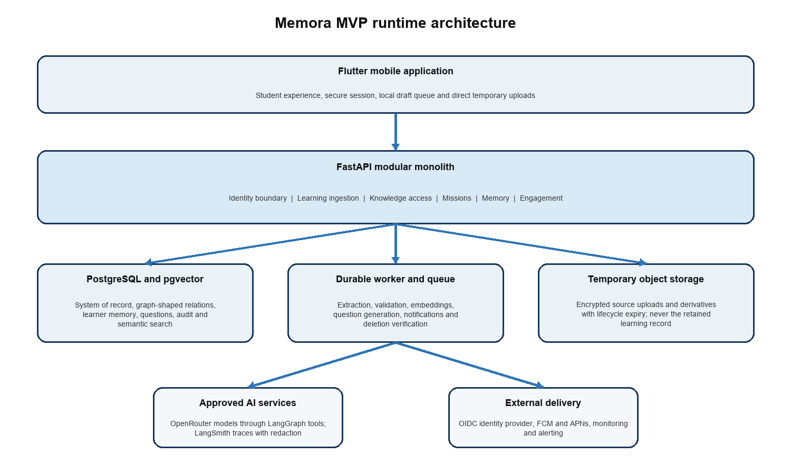
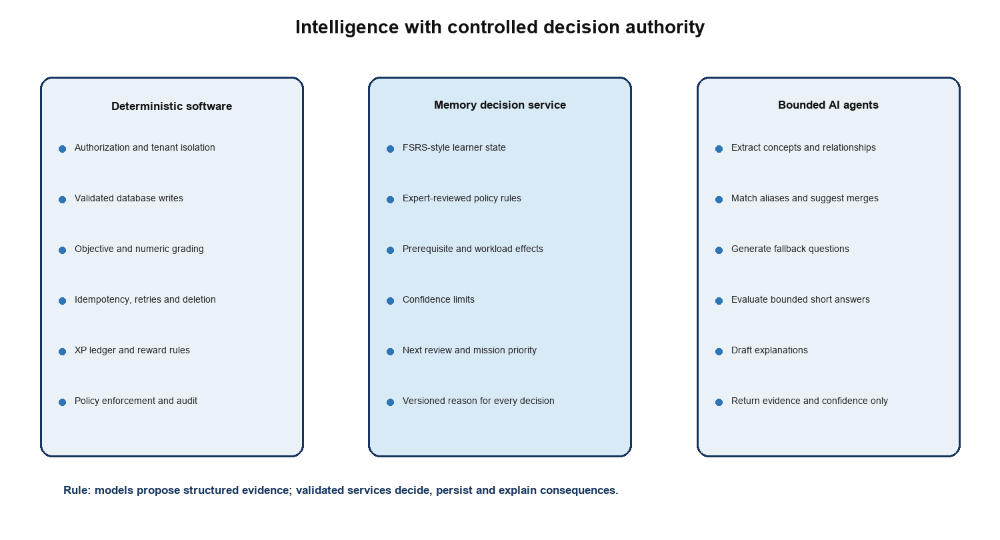
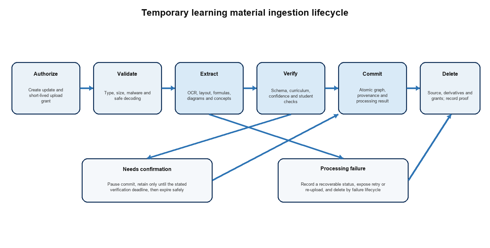

<!-- Text equivalent of Memora_TRD.docx. Keep the DOCX and Markdown versions synchronized. -->

# Memora Technical Requirements Document

**Student first MVP for Sri Lankan GCE Advanced Level Physics**

Version 1.0

Prepared 22 October 2026

This document translates the approved Memora product requirements into an implementable technical design. It defines system boundaries, runtime architecture, data responsibilities, intelligent decision controls, security requirements, service contracts, operational targets and verification gates for the student-first A/L Physics MVP.

Source product boundary: Memora Product Requirements Document version 1.0

Primary readers: engineering, AI, security, data, quality assurance and operations teams

## Executive summary

Memora will be delivered as a Flutter mobile application backed by a FastAPI modular monolith, a durable asynchronous worker and PostgreSQL with pgvector. PostgreSQL is the transactional source of truth. The subject knowledge graph is stored as typed relational nodes and edges so normal transactions, learner state and graph relationships share one secure boundary. pgvector supports semantic matching and grounded retrieval. A separate graph database is not required for the MVP and may be introduced only after measured query or scale limits justify it.

The product is intelligent because several techniques cooperate under explicit authority boundaries. A versioned FSRS-style memory model estimates concept retrievability. Expert-reviewed rules apply workload, prerequisite, uncertainty and safety policy. Graph reasoning supplies dependencies and misconception context. LangGraph agents use approved OpenRouter models for extraction, bounded grading and grounded fallback content; semantic embeddings run in the private self-hosted service. AI output is evidence, never unrestricted authority: deterministic services validate writes, compute schedules, enforce permissions and record every consequence.

Uploaded PDFs, photos, images and diagrams are temporary processing inputs. They are encrypted, isolated and deleted after a validated knowledge commit or a bounded failure or verification period. The retained record is structured knowledge, confidence, provenance references, processing evidence and learner memory state—not the original file.

### Locked architectural decisions

| **Area** | **MVP decision** | **Reason** |
| --- | --- | --- |
| Application shape | Modular monolith plus separate worker | Preserves clear boundaries without premature distributed-system complexity |
| Mobile | Flutter and Dart | One product codebase for Android and iOS while following the approved Figma system |
| API | Versioned REST JSON through FastAPI | Clear mobile contracts, OpenAPI generation and simple observability |
| Primary data | Managed PostgreSQL | Transactions, constraints, reporting and strong ecosystem |
| Semantic retrieval | pgvector in PostgreSQL | Keeps embeddings beside authorized records and avoids another database |
| Knowledge graph | Typed node and edge tables with recursive SQL | Satisfies MVP graph queries while preserving one source of truth |
| AI orchestration | LangGraph with LangChain adapters and LangSmith observability | Bounded workflows, tool control, evaluation and traceability |
| Model access | OpenRouter gateway for generative tasks; private self-hosted embedding service | Provider flexibility without exposing private notes to retaining embedding endpoints |
| Deployment | Managed containers, managed PostgreSQL, object storage and durable queue | Security and recovery without Kubernetes in the MVP |
| Graphify | Development-time repository map and change-impact aid | Improves code navigation; it is not the student knowledge graph runtime |

*Figure 1  MVP runtime architecture*

## 1 Purpose scope and constraints

### 1.1 Purpose

The TRD defines how engineering will satisfy the PRD. It is the canonical source for architectural and non-functional decisions. The Backend Schema document will later define complete entities, fields, constraints and migrations; the App Flow document will define every screen state and transition.

### 1.2 In scope

- Individual student accounts and one launch subject: Sri Lankan GCE Advanced Level Physics.
- Multiple daily learning updates, including text and temporary PDF or image uploads.
- Knowledge extraction, validation, graph commit, provenance and verified deletion.
- Concept-level memory state, Daily Mission planning, grading, explanations and rescheduling.
- Verified-first questions with grounded AI fallback under confidence controls.
- Mora, XP, streak grace and the evidence-driven Physics reef.
- Secure notifications, data export, account deletion, observability and pilot operation.
### 1.3 Out of scope

- Teacher accounts, classrooms, assignments and classroom analytics.
- Additional subjects, public profiles, leaderboards, social feeds and direct messages.
- An unrestricted tutoring chatbot, live classes or institution administration.
- Microservices, Kubernetes, a dedicated graph database and multi-region active-active operation.
- A full offline learning engine. The app preserves drafts and retries safely but requires connectivity for ingestion and synchronized missions.
### 1.4 Planning assumptions

| **Assumption** | **Initial engineering value** | **Change control** |
| --- | --- | --- |
| Pilot population | Up to 2,000 registered and 500 daily active students | Load test before raising the cap |
| Peak concurrency | 200 active API clients and 20 upload jobs per minute | Capacity plan uses measured pilot traffic |
| Upload cap | 20 MB per file, 30 PDF pages or 10 images per learning update | Product and security approval required to increase |
| Normal mission | 3 to 7 minutes and a bounded item count | Memory policy configuration, not client logic |
| Data region | One approved region close to Sri Lanka | Legal and provider review before launch |
| Language | One launch medium selected before content production | Other languages use separately versioned content |

## 2 Technical goals and quality requirements

### 2.1 Quality priorities

**1. **Protect academic correctness and private learning data before optimizing engagement or model convenience.

**2. **Make each memory consequence reproducible from versioned evidence and policy.

**3. **Complete the core loop reliably under retries, duplicate requests and partial model failure.

**4. **Keep the MVP operable by a small team through one deployable backend and one durable worker.

**5. **Collect enough calibrated evidence to improve scheduling without silently experimenting on students.

### 2.2 Service level objectives

The following are pilot targets. AI and document-processing latency is measured separately from normal API latency so model delays do not obscure core service health.

| **Area** | **Pilot target** | **Measurement** |
| --- | --- | --- |
| Availability | 99.5% monthly for authenticated core API | Successful eligible requests at the API edge |
| Standard API latency | p95 below 400 ms | Reads and transactional writes excluding file and model processing |
| Mission start | p95 below 2 seconds | Request to first locally renderable mission payload |
| Objective grading | p95 below 750 ms | Answer receipt to persisted feedback |
| Ingestion | 90% of valid 10-page PDFs complete within 2 minutes | Upload finalization to committed knowledge or verification state |
| Notification timing | 95% begin delivery within 5 minutes of planned window | Server enqueue timestamp to provider acceptance |
| Durability | No acknowledged learning update or answer is silently lost | Idempotency and reconciliation checks |
| Recovery point | 15 minutes or better | Managed database backup and point-in-time recovery |
| Recovery time | 4 hours for the pilot | Documented restore exercise |

### 2.3 Technical requirements

| **ID** | **Requirement** | **Verification** |
| --- | --- | --- |
| TRD 001 | All externally visible API contracts are versioned and described by generated OpenAPI. | Contract tests compare server behavior with the published schema. |
| TRD 002 | Every accepted write supports an idempotency strategy appropriate to its operation. | Repeated-request tests produce one logical result. |
| TRD 003 | Every memory or reward consequence references a versioned decision record. | Audit query reproduces the inputs, policy version and output. |
| TRD 004 | AI failure cannot prevent account access, data export, verified-question quizzes or deletion requests. | Dependency-failure tests exercise degraded operation. |
| TRD 005 | No mobile client can directly access databases, model providers, queues or internal administration APIs. | Network and credential review confirms server-only boundaries. |
| TRD 006 | Security, accessibility and observability checks are release gates rather than post-launch tasks. | CI and release checklist require recorded results. |

## 3 System architecture

### 3.1 Architecture style

The backend is a modular monolith: one FastAPI codebase and deployable API artifact organized into modules with explicit interfaces. Long-running or retryable work executes in a worker built from the same application modules. This avoids network calls between business capabilities while preserving a path to extract a service only when load, ownership or isolation requires it.

### 3.2 Backend modules

| **Module** | **Owns** | **Must not own** |
| --- | --- | --- |
| Identity and access | User profile link, sessions, consent, authorization context | Provider credentials or learning decisions |
| Learning ingestion | Updates, upload lifecycle, processing status, extraction orchestration | Final memory scheduling |
| Knowledge | Concepts, claims, aliases, typed edges, provenance and retrieval plans | User authentication or reward policy |
| Assessment | Question versions, attempts, grading, reports and disputes | Direct next-review writes |
| Memory | Learner-concept state, policy rules, mission priority and schedule decisions | Question authoring |
| Engagement | XP ledger, streak state, permanent inventory and reef projection | Recall estimates |
| Notification | Preferences, due notification jobs and provider delivery results | Mission selection |
| Privacy and audit | Export, deletion workflow, security audit and data-retention controls | Business-content generation |

### 3.3 Dependency rules

- HTTP handlers validate transport data and call application services; they do not contain scheduling or extraction logic.
- Modules exchange typed commands, queries and events. They do not import another module's persistence implementation.
- Database transactions are owned by the application use case. Cross-module updates that must be atomic execute in one transaction.
- External providers are behind narrow adapters selected by server configuration and allowlists.
- Domain events use an outbox table so committed changes and queued work cannot diverge.
### 3.4 When architecture may change

A module may become a separate service only when measurements show an independent scaling, fault-isolation, security or team-ownership need. A separate graph store may be evaluated when representative graph queries miss their latency target after indexing and query tuning, or when relationship depth and volume make relational traversal operationally unsafe. The PostgreSQL record remains authoritative during any migration.

## 4 Software intelligence and AI authority

*Figure 2  Decision authority boundaries*

### 4.1 Responsibility matrix

| **Capability** | **Primary mechanism** | **AI role** | **Final authority** |
| --- | --- | --- | --- |
| Authentication | OIDC and deterministic authorization | None | Identity and access service |
| Document extraction | Parsers, OCR and schema validators | Interpret layout, concepts and relationships | Ingestion validation service |
| Knowledge merge | Identifiers, constraints and similarity thresholds | Suggest alias or duplicate candidates | Knowledge commit service |
| Memory schedule | FSRS-style model plus reviewed rules | May classify misconception evidence | Memory decision service |
| Question selection | Coverage, trust, due state and diversity rules | Generate only when verified coverage is absent | Mission planner |
| Objective grading | Stored keys and numeric tolerances | None | Assessment service |
| Short-answer grading | Stored rubric and confidence limits | Produce rubric-scored evidence | Assessment validation service |
| Reef state | Deterministic projection of memory evidence | None | Engagement projection service |
| Explanations | Templates plus evidence | May draft grounded wording | Response validator |

### 4.2 Prohibited AI authority

- Models cannot execute free-form SQL, select arbitrary storage, bypass row ownership or call unapproved network destinations.
- Models cannot directly set due dates, XP, streaks, reef health, consent, account status or deletion state.
- Models cannot promote private student material into shared curriculum content.
- A model's confidence text is not trusted as a calibrated probability; server validation and evaluation determine influence.
- Unsupported or contradictory output is withheld rather than repaired invisibly into a high-impact decision.
## 5 Mobile application architecture

### 5.1 Flutter structure

| **Layer** | **Responsibility** | **Recommended implementation** |
| --- | --- | --- |
| Presentation | Screens, components, animation, accessibility and responsive layout | Feature folders using approved Figma tokens and components |
| State | Screen state and async orchestration | Riverpod providers with immutable state |
| Navigation | Guarded routes and deep links | go_router with authentication and active-mission guards |
| Networking | REST client, auth refresh, retries and request IDs | Dio with generated or typed DTO mapping |
| Secure storage | Refresh token or provider session material | OS keychain or keystore through flutter_secure_storage |
| Local persistence | Draft learning updates, pending answer envelopes and cache metadata | Small SQLite store; no complete private knowledge replica |
| Notifications | Permission, token registration and deep-link handling | FCM and APNs through one notification adapter |

### 5.2 Offline and retry behavior

- Text learning updates may be saved locally as drafts until a connection is available.
- An answer submission receives a client operation ID. A timeout may be retried without creating a second attempt.
- The current downloaded mission may continue through brief connection loss, but feedback requiring server grading displays a pending state.
- Upload bytes are not copied into a long-lived app cache. Temporary local files follow platform cleanup rules and are removed after completion or cancellation.
- The app never invents a schedule locally. It displays the last synchronized decision and clearly marks stale state.
### 5.3 Design implementation

The approved Figma file is the visual source of truth for exact colours, gradients, fonts, Mora artwork, component geometry and motion. Engineering converts these into versioned design tokens and reusable Flutter components. Reef condition variants must combine saturation with coral density, water clarity, lighting, movement and wildlife activity so Needs Care and Stressed states remain distinct without relying on colour alone.

## 6 API design

### 6.1 Conventions

- Base path is /v1. Breaking changes require a new major path; additive fields remain backward compatible.
- JSON uses snake_case, ISO 8601 UTC timestamps and opaque UUID identifiers.
- Errors use one envelope containing code, safe message, request ID, field errors and retry guidance.
- Mutation endpoints accept an Idempotency-Key or a stable client operation ID where duplicate delivery is possible.
- Collection endpoints use cursor pagination. Clients never infer database ordering from UUIDs.
- Every authenticated request carries a correlation ID and an authorization context created by the server.
### 6.2 MVP resource surface

| **Resource** | **Representative operations** | **Notes** |
| --- | --- | --- |
| session | bootstrap, revoke, device registration | Authentication occurs through the approved OIDC provider |
| profile | read, update preferences, consent status | Sensitive changes require recent authentication |
| learning updates | create, finalize upload, inspect status, verify extraction | Supports multiple updates per day |
| missions | today, start, answer, complete | Server owns selection and authoritative progress |
| concept progress | summary, due reasons, history | Returns explanations without internal model secrets |
| seabed | current projection, reef detail, inventory | Projection is rebuildable from authoritative state |
| questions | report, dispute status | Question authoring is not a student API |
| privacy | export request, deletion request, status | Long-running workflow with step-up verification |

### 6.3 Upload protocol

**1. **The client creates a learning update and sends declared file metadata.

**2. **The API returns a short-lived, single-purpose signed upload grant and upload identifier.

**3. **The client uploads directly to the temporary object store over TLS.

**4. **The client finalizes the upload. The server verifies object identity and queues processing once.

**5. **The client polls or receives an event-backed status until verification, commit, failure or expiry.

## 7 Storage and query architecture

### 7.1 Storage responsibilities

| **Store** | **Retains** | **Does not retain** |
| --- | --- | --- |
| PostgreSQL | Users, consent, updates, structured knowledge, graph edges, memory state, question versions, attempts, rewards, audit and job metadata | Raw upload bytes or model secrets |
| pgvector | Embeddings attached to authorized concepts, claims and question content | Unscoped global vectors or source files |
| Temporary object storage | Encrypted upload bytes and bounded processing derivatives | Permanent student learning record |
| Queue | Opaque job references and retry metadata | Document content when an object reference is sufficient |
| Mobile SQLite | Drafts, pending operation envelopes and non-sensitive cache metadata | Server credentials, full knowledge graph or authoritative schedule |
| Observability systems | Metrics, safe event attributes and redacted traces | Student note text, answers or access tokens |

### 7.2 Who decides where to query

Application code—not an unconstrained agent—selects the query path through a Knowledge Access Service. Each use case requests a typed capability. The service compiles an authorized retrieval plan and returns typed results.

| **Intent** | **Query path** | **Example** |
| --- | --- | --- |
| Exact transactional state | Indexed SQL | Current learner-concept state or question version |
| Semantic similarity | pgvector with ownership and curriculum filters | Match extracted phrase to an existing concept alias |
| Relationship traversal | Typed edge SQL and bounded recursive CTE | Find prerequisites within two hops |
| Combined retrieval | Server-composed SQL, vector and graph plan | Ground a question with similar claims and their prerequisites |
| Analytical aggregate | Read replica or governed aggregate query when introduced | Pilot recall calibration by confidence band |

### 7.3 PostgreSQL rules

- Use foreign keys, unique constraints and check constraints for invariants that the database can enforce.
- Use UTC timestamptz values and preserve curriculum, content, rubric, embedding and engine versions.
- Use row-level security as defense in depth where practical; service authorization remains mandatory.
- Partition only after measured table growth requires it. Begin with targeted composite and partial indexes.
- Schema changes use reviewed forward migrations and a tested rollback or roll-forward procedure.
## 8 Knowledge graph implementation

### 8.1 Graph model

The graph separates shared curriculum knowledge from private learner state. Shared Physics concepts and reviewed claims are versioned and reusable. Private extracted claims remain scoped to the student until matched to approved curriculum knowledge; they are never silently shared.

| **Element** | **Purpose** | **Examples** |
| --- | --- | --- |
| Concept node | Stable subject idea or skill | Newton second law, displacement, vector addition |
| Claim | Versioned testable statement | Force equals rate of change of momentum under stated conditions |
| Alias | Term or symbol mapping | g, gravitational field strength, acceleration due to gravity |
| Typed edge | Semantic relationship | prerequisite_of, applies_under, contradicts, example_of, misconception_about |
| Evidence link | Why an item exists | Learning update, verified source, question attempt or reviewer action |
| Learner overlay | Student-specific exposure and memory | First learned time, stability, due time, confidence |

### 8.2 Graph rules

- Node and edge types come from an allowlisted ontology; model-generated types are rejected.
- Edges have direction, version, confidence, provenance and lifecycle state.
- Traversal depth and result count are bounded to protect latency and prevent irrelevant expansion.
- A vector match proposes candidates; it does not merge identities without deterministic thresholds or review.
- Conflicting claims remain explicit and cannot be averaged into one statement.
- Every question and memory item maps to one or more versioned concepts and learning objectives.
### 8.3 Graph database decision gate

Neo4j or another graph database is not part of the MVP. Evaluation begins only if production-like benchmarks show that the required bounded traversals cannot meet p95 targets in PostgreSQL after correct indexes, materialized paths or cached projections. Adoption requires a synchronization design, ownership model, backup plan and demonstrated benefit greater than the consistency and operational cost.

## 9 Memory engine

### 9.1 Hybrid design

An expert system alone is not the best scheduler because fixed rules cannot efficiently learn each student's forgetting behavior. A pure machine-learning or LLM scheduler is also unsuitable because it is difficult to bound and explain. Memora therefore uses a hybrid: an FSRS-style quantitative state model for memory dynamics, a compact expert-reviewed policy layer for educational constraints, and knowledge-graph signals for prerequisite impact.

### 9.2 Learner concept state

| **State** | **Meaning** | **Update source** |
| --- | --- | --- |
| Difficulty | Estimated inherent challenge for this learner and concept | Repeated retrieval evidence with bounded updates |
| Stability | Expected time over which recall remains durable | Validated review outcome and elapsed time |
| Retrievability | Current estimated probability of successful recall | Computed at decision time |
| Evidence confidence | Trust in grading and concept mapping | Question source, rubric, grader and dispute state |
| Last review and due time | Temporal anchors for planning | Committed scheduling decision |
| Lapse and exposure counts | History used without treating every interaction equally | Eligible attempt events |

### 9.3 Expert-reviewed rules

- Cap total mission workload and prioritize rather than multiplying overdue work.
- Limit the influence of low-confidence extraction or grading evidence.
- Trigger Recover work when a weak prerequisite explains failure in a dependent concept.
- Do not let one incorrect response collapse the subject or reef state.
- Use actual elapsed time after absence and create a welcoming comeback mission.
- Keep required curriculum coverage and safety constraints even if engagement optimization suggests otherwise.
### 9.4 Mission priority

The initial planner ranks eligible work from urgency, estimated forgetting risk, prerequisite impact, recent error severity and curriculum coverage. Weights are versioned configuration and must be calibrated with pilot evidence. Selection then applies diversity, trust-source, workload and repetition constraints. The client never receives hidden candidate pools or computes priority.

### 9.5 Scheduling safeguards

| **Risk** | **Safeguard** |
| --- | --- |
| Incorrect AI grading | Confidence-weighted evidence, low-impact provisional updates and student dispute path |
| Sparse new-user data | Conservative defaults by question type and curriculum concept, then gradual personalization |
| Gaming or guessing | Attempt pattern signals and lower weight for unsupported rapid guesses |
| Backlog explosion | Daily cap, representative sampling and bounded comeback mode |
| Policy drift | Versioned engine, shadow evaluation and explicit rollout cohorts |
| Unexplainable date | Persist reason codes, inputs and human-readable explanation template |

## 10 Agentic system

### 10.1 LangGraph workflows

| **Graph** | **Nodes** | **Terminal outcomes** |
| --- | --- | --- |
| Ingestion graph | validate, parse, extract, normalize, map, verify, commit, delete | committed, needs confirmation, failed safely, expired |
| Question fallback graph | retrieve evidence, draft, solve independently, validate, label, store ephemeral or reviewed | eligible, rejected, review required |
| Short-answer graph | load rubric, normalize response, evaluate claims, validate confidence, produce evidence | graded, needs confirmation, manual dispute |
| Explanation graph | load decision facts, draft wording, check grounding and safety | approved response or deterministic template |

### 10.2 LangChain usage

LangChain provides model adapters, structured-output parsing, document utilities and tool interfaces. Domain behavior remains in Memora services and schemas; the application does not depend on generic chains for authorization, database transactions or scheduling.

### 10.3 LangSmith usage

- Trace workflow step names, model identifier, prompt version, token use, latency, validation outcome and safe error class.
- Redact or hash user identifiers and exclude original files, note text, answer text and secrets from default traces.
- Maintain offline evaluation datasets for extraction, mapping, generation and grading before model or prompt promotion.
- Separate development traces from production and apply approved retention and access controls.
### 10.4 OpenRouter gateway

- Only the backend gateway holds the OpenRouter key. Mobile clients never receive it.
- Each task uses an allowlisted model class, maximum token budget, timeout, retry policy and data-handling rule.
- The gateway records provider and model version, applies circuit breakers and can disable a route without an app release.
- Sensitive tasks use providers approved by privacy review. Provider retention or training settings must meet the recorded policy.
- Fallback changes availability, not authority: all model outputs pass the same validators.

### 10.5 Private embedding service

- The worker calls the self-hosted NVIDIA Nemotron 3.5 Embed 1B service over a private authenticated network path.
- Student text is bounded to the minimum fragment required for embedding and is not logged by the caller or service.
- The service does not persist request bodies or vectors; PostgreSQL stores authorized vectors and their model key.
- Public or free hosted embedding endpoints are not fallback routes for private material.
## 11 Learning ingestion and deletion

*Figure 3  Temporary upload lifecycle*

### 11.1 Processing stages

| **Stage** | **Required controls** | **Stored result** |
| --- | --- | --- |
| Authorize | Ownership, quota, declared type and single-purpose grant | Learning update and upload record |
| Validate | Magic-byte detection, size and page limits, malware scan and safe decoder | Validation evidence or safe failure |
| Extract | Sandboxed parsing, OCR, layout, formula and diagram analysis | Temporary normalized fragments |
| Map | Curriculum filter, ontology schema, alias match and provenance | Candidate concepts, claims and edges |
| Verify | Confidence rules, contradiction checks and targeted student confirmation | Approved or rejected candidate set |
| Commit | Serializable or otherwise integrity-safe transaction and outbox event | Versioned knowledge and processing result |
| Delete | Object versions, derivatives and grants removed; retries and reconciliation | Deletion timestamp, scope and verification state |

### 11.2 Deletion guarantee

The system may state that an upload is deleted only after the deletion worker confirms removal of the source object and tracked derivatives. Object-store lifecycle rules provide defense in depth but are not the sole proof. A scheduled reconciler identifies expired or orphaned objects. Backups do not intentionally contain upload objects; database metadata follows the approved retention schedule.

### 11.3 Failure handling

- Every stage is restartable from durable state and is idempotent for the same upload version.
- A poison document cannot block the queue; retry count is bounded and terminal failure is visible.
- Student confirmation has an expiry. On expiry, uncommitted temporary content is deleted and the update explains what must be re-uploaded.
- Committed knowledge is never removed merely because source deletion succeeds; deleting the account is a separate privacy workflow.
## 12 Questions grading and feedback

### 12.1 Source precedence

Mission planning selects eligible questions in this order: verified expert-authored, future authorized teacher-authored, then grounded AI-generated fallback. The source class and content version are stored with every attempt. A source-precedence rule may be overridden only for measured diversity or when the verified item is ineligible because of repetition, dispute or mismatch.

### 12.2 Grading

| **Format** | **Method** | **Memory influence** |
| --- | --- | --- |
| MCQ | Exact versioned key with option-order mapping | Full when question and attempt are valid |
| Numeric | Parsed quantity, unit policy, tolerance and significant-figure rule | Full or partial from deterministic rubric |
| Bounded short answer | Claim rubric plus structured model evaluation | Confidence-limited; confirmation when ambiguous |
| Diagram interpretation | Verified options or bounded labelled response in the MVP | Only validated evidence affects schedule |

### 12.3 Generated question validation

**1. **Retrieve authorized concept claims, conditions, units and misconceptions.

**2. **Generate a question, answer, reasoning and concept mapping in a strict schema.

**3. **Solve or check the question independently using deterministic tools where possible.

**4. **Reject unsupported statements, ambiguous wording, invalid options, duplicated answers or curriculum mismatch.

**5. **Apply the AI-generated label and lower default evidence ceiling until quality is demonstrated.

### 12.4 Disputes

A reported question or grading decision enters a review state and is excluded from high-impact future updates when the report meets configured criteria. Existing attempts preserve the original content and rubric version. Resolution can confirm, regrade or invalidate the evidence and then recompute affected memory decisions through a controlled job.

## 13 Missions and game-state projection

### 13.1 Mission assembly

- A Daily Mission is a persisted plan with an engine version, candidate snapshot and expiry.
- Protect, Repair, Recover, Discover and Challenge describe learning purpose, not arbitrary game modes.
- Starting a mission locks or versions its question references so content edits do not change an active attempt.
- Completion is based on persisted eligible answers; reconnection cannot duplicate XP or schedule updates.
### 13.2 Engagement state

| **State** | **Source** | **Rule** |
| --- | --- | --- |
| XP | Eligible learning events | Append-only ledger with unique source event; no award for app open or repeated upload |
| Streak | Completed useful mission days | One weekly grace day; timezone change protection and no permanent loss |
| Inventory | Reward grants | Permanent ownership; cosmetics have no scheduling advantage |
| Reef condition | Memory projection | Rebuildable from recall, overdue burden, prerequisite risk and recent evidence |
| Visual variant | Condition plus approved design tokens | State differs by structure, lighting, clarity and activity as well as colour |

## 14 Identity authorization and security

### 14.1 Identity

Use a managed OpenID Connect identity provider. The reference deployment may use Amazon Cognito, but the application depends on OIDC contracts rather than provider-specific tokens. Access tokens are short-lived. Refresh or provider session material is stored only in the operating-system secure store. Account recovery, email or phone verification and future age controls follow provider and product policy.

### 14.2 Authorization

- The API derives the user identifier and roles from a validated token; it never accepts ownership from request JSON.
- Every private query includes the authorization scope. Object keys are random and bound to an upload owned by that scope.
- Administrative and academic-review functions use separate roles, step-up authentication and audited actions.
- Future classrooms require explicit membership and purpose-scoped grants; no teacher access is implied by this MVP schema.
### 14.3 Security controls

| **Control area** | **Requirement** |
| --- | --- |
| Transport | TLS 1.2 or later; certificate validation; no plaintext internal secrets |
| Encryption | Managed encryption at rest for database, object storage, backups and queue; keys controlled through KMS |
| Secrets | Secrets manager, workload identities, rotation and no secrets in source, mobile builds or logs |
| Upload defense | Type verification, limits, malware scan, sandboxed parsing, decompression limits and randomized paths |
| API defense | Schema validation, rate limits, abuse detection, CORS restrictions where relevant and safe errors |
| Prompt injection | Uploaded text is untrusted data; agents have allowlisted tools and cannot treat document instructions as authority |
| Supply chain | Locked dependencies, automated vulnerability and secret scans, SBOM and signed release artifacts |
| Audit | Append-only security events for access changes, exports, deletion, review actions and policy changes |

### 14.4 Threat-model priorities

| **Threat** | **Primary mitigation** |
| --- | --- |
| Cross-user data access | Server-derived ownership, negative authorization tests and database defense in depth |
| Malicious document | Isolated parsing, strict resource limits, no macros or active content and malware screening |
| Prompt injection | Untrusted-content boundary, schema-only outputs and no privileged model tools |
| Question poisoning | Source provenance, verified precedence, review workflow and versioned attempts |
| Token theft | Secure mobile storage, short access lifetime, revocation and anomalous-session detection |
| Silent retention | Deletion state machine, object reconciliation and retention monitoring |
| Cost denial | Per-user quotas, job admission control, model budgets and circuit breakers |

## 15 Privacy and data governance

### 15.1 Data classes

| **Class** | **Examples** | **Handling** |
| --- | --- | --- |
| Account | Identity provider ID, contact and consent | Restricted access, encrypted and exportable |
| Private learning | Learning updates, concepts, answers and memory state | User scoped; excluded from default logs and traces |
| Temporary source | PDFs, note photos and derivatives | Shortest bounded retention and verified deletion |
| Shared academic | Approved curriculum, concepts and verified questions | Reviewer-controlled versions and provenance |
| Operational | Metrics, request IDs and safe event attributes | Minimized, retention-limited and access-controlled |
| Security audit | Consent, export, deletion and privileged actions | Tamper-resistant retention under approved policy |

### 15.2 Governance requirements

- Maintain a data inventory with owner, purpose, legal basis, location, retention and deletion behavior.
- Collect only data required for the learning loop, security, support and agreed measurement.
- Record the policy and consent version governing uploads and model processing.
- Export data in a documented machine-readable package plus a student-readable summary.
- Account deletion is a durable workflow covering database state, vectors, temporary objects, notification tokens and eligible provider data.
- Complete Sri Lankan legal, child-user and cross-border processing review before public registration.
## 16 Background work and reliability

### 16.1 Queue model

Use a managed durable queue with separate job classes for ingestion, AI, notifications, export, deletion and reconciliation. The worker acknowledges only after durable state is committed. Dead-letter queues and bounded retry policies prevent repeated expensive or unsafe processing.

### 16.2 Reliability patterns

| **Pattern** | **Use** |
| --- | --- |
| Transactional outbox | Publish jobs or domain events only from committed business changes |
| Idempotent consumer | Recognize the same job or operation and return the existing logical result |
| Lease and heartbeat | Recover work from crashed workers without concurrent duplicate ownership |
| Exponential backoff | Retry transient providers while respecting total time and cost limits |
| Circuit breaker | Stop failing model or notification routes and preserve degraded core operation |
| Reconciler | Detect stuck updates, orphaned objects, missing deletion proofs and projection drift |
| Replayable projection | Rebuild reef and selected aggregates from authoritative events and state |

### 16.3 Backup and recovery

- Enable encrypted automated database backups and point-in-time recovery.
- Test restoration into an isolated environment before the pilot and at a defined cadence afterward.
- Version infrastructure configuration and deployment manifests so service recovery does not depend on console memory.
- Do not restore expired temporary uploads as active content. Restoration procedures immediately reapply deletion reconciliation.
## 17 Observability evaluation and analytics

### 17.1 Operational telemetry

| **Signal** | **Required dimensions** | **Alert examples** |
| --- | --- | --- |
| API | route class, status, latency and app version | error-rate or latency burn |
| Jobs | type, state, attempt, age and terminal reason | queue age, dead letters or stuck deletion |
| Database | connections, locks, query class and replication or backup health | pool exhaustion or slow-query regression |
| AI | task, allowed model, prompt version, tokens, validation and latency | validation failure or cost spike |
| Learning | mission type, source class and anonymized outcome band | calibration drift or disputed-content spike |
| Security | auth failures, rate limits, privileged actions and anomalous access | cross-scope denial spike or credential abuse |

### 17.2 Product analytics rules

- Define events in a versioned catalog with purpose and allowed properties.
- Do not place source text, answer text, tokens or direct identifiers in analytics payloads.
- Measure verified and AI-generated question outcomes separately.
- Use useful learning events for retention metrics; app opens are not a substitute.
- Experiments affecting scheduling or pedagogy require review, cohort controls and a rollback path.
### 17.3 Model and memory evaluation

- Extraction: concept precision and recall, formula accuracy, relationship accuracy and confirmation rate.
- Question generation: factual support, answerability, ambiguity, curriculum alignment and duplicate rate.
- Short-answer grading: agreement with expert rubric, false-negative and false-positive rates, and confidence calibration.
- Memory engine: predicted versus observed recall, workload distribution, lapse recovery and subgroup checks.
- Every production promotion records dataset version, evaluator, result, model or policy version and approval.
## 18 Deployment and environments

### 18.1 Reference deployment

The reference architecture uses a cloud region approved for latency and data governance: managed container tasks for API and worker, managed PostgreSQL with pgvector, encrypted object storage, a managed durable queue, load balancer or API edge, secrets manager, KMS and centralized monitoring. AWS ECS Fargate, RDS PostgreSQL, S3 and SQS are suitable reference services. Equivalent managed services may be selected only if they meet the same controls.

### 18.2 Environments

| **Environment** | **Purpose** | **Data rule** |
| --- | --- | --- |
| Local | Developer feedback and unit tests | Synthetic fixtures only |
| Development | Shared integration and agent experiments | Synthetic or explicitly approved de-identified samples |
| Staging | Production-like release, load and security verification | Synthetic datasets matching production shape |
| Production | Pilot and live students | Approved access, monitoring and retention policy |

### 18.3 Delivery pipeline

**1. **Format, static analysis, unit tests, migration checks, dependency and secret scans.

**2. **Build pinned mobile and container artifacts and generate an SBOM.

**3. **Run contract, integration, authorization and agent evaluation gates.

**4. **Deploy to staging, run smoke and migration rehearsal, then approve production rollout.

**5. **Use gradual backend and model-policy rollout with health and learning guardrails.

**6. **Retain a tested rollback path; irreversible migrations use expand-and-contract deployment.

### 18.4 Repository intelligence

Ponytail guides implementation toward the smallest complete change. Graphify is used in development and CI to map modules, callers and change impact before cross-cutting edits. Neither changes runtime authorization or knowledge storage. Generated dependency graphs are engineering artifacts and must not include secrets or student data.

## 19 Testing strategy

### 19.1 Test layers

| **Layer** | **Minimum coverage** |
| --- | --- |
| Unit | Memory calculations, policy rules, grading, reef projection, validators and authorization predicates |
| Property and simulation | Scheduling bounds, idempotency, timezones, long absence and evidence-order invariants |
| Database | Constraints, migrations, recursive graph queries, vector filters and row isolation |
| Contract | Flutter DTOs against OpenAPI and external-provider adapters against recorded fixtures |
| Integration | Upload through commit and deletion; mission through answer, memory and reward |
| Agent evaluation | Frozen datasets and thresholds for every model or prompt change |
| Security | Threat-model cases, dependency scans, mobile storage, API abuse and penetration testing |
| Performance | API, mission assembly, graph traversal, ingestion queue and database recovery under pilot load |
| Accessibility | Screen readers, scalable text, focus, touch targets, contrast and reduced motion |
| End to end | The complete PRD release scenario on supported Android and iOS devices |

### 19.2 Critical invariants

- The same answer operation cannot create two attempts, two memory updates or two XP grants.
- A user cannot read or mutate another user's private update, mission, answer, memory or upload.
- A deleted or expired temporary object cannot be referenced as available.
- A model result that fails schema, grounding or confidence checks cannot change authoritative state.
- Replaying authoritative events produces the same engagement projection for the same engine version.
- Question edits never change the historical version attached to an attempt.
## 20 Requirement traceability

| **PRD area** | **Primary technical sections** | **Evidence** |
| --- | --- | --- |
| Account and onboarding | 5, 6, 14 and 15 | Auth, consent, secure storage and privacy workflow tests |
| Learning ingestion | 6, 7, 8 and 11 | Upload lifecycle, graph commit and deletion reconciliation |
| Memory and missions | 9, 12, 13 and 19 | Simulation, calibration, idempotency and end-to-end tests |
| Question trust | 10 and 12 | Source precedence, generation evaluation, grading and dispute tests |
| Game experience | 5 and 13 | Projection tests, accessibility review and non-farmable reward tests |
| Notifications | 5, 6 and 16 | Quiet-hour, retry and delivery tests |
| Privacy and security | 11, 14, 15 and 16 | Threat review, deletion proof, export and recovery exercise |
| Operational release | 2, 17, 18 and 19 | SLO dashboard, CI gates, staging rehearsal and runbooks |

## 21 Architecture decisions and rejected alternatives

| **Decision** | **Chosen** | **Rejected for MVP** | **Revisit trigger** |
| --- | --- | --- | --- |
| Backend shape | Modular monolith and worker | Microservices | Independent scale, isolation or ownership demonstrated |
| Graph storage | PostgreSQL typed edges | Neo4j as a second source | Representative traversal misses target after tuning |
| Scheduler | FSRS-style model plus expert rules | Pure expert system or LLM scheduler | Only after controlled evidence shows a safer improvement |
| API | REST and OpenAPI | GraphQL | Several clients prove costly over-fetch or composition needs |
| Uploads | Temporary object storage | Permanent source archive | Explicit product and privacy revision |
| Orchestration | LangGraph for bounded AI workflows | Free-form autonomous agent | No planned trigger; prohibited for high-impact authority |
| Deployment | Managed containers | Kubernetes | Operational scale and team capacity justify it |
| Semantic embeddings | Self-hosted NVIDIA Nemotron 3.5 Embed 1B, 2048 dimensions | OpenRouter free endpoint or larger model | Approved evaluation shows a material retrieval, availability or cost benefit without weakening private-note handling |

## 22 Open technical decisions

| **Decision** | **Owner** | **Required before** | **Recommended action** |
| --- | --- | --- | --- |
| Identity provider | Security and engineering | Authentication implementation | Compare OIDC providers against age, recovery, region and cost needs |
| Cloud region and final provider | Security and operations | Production infrastructure | Complete data-location, latency and service review |
| Model allowlist | AI and privacy | Production agent evaluation | Approve each task, provider, retention setting and fallback |
| Retention schedule | Privacy and security | Pilot data collection | Approve periods for temporary, operational, audit and deleted data |
| Verified question coverage | Academic and product | Pilot launch | Set minimum coverage per Physics unit and objective |
| Memory defaults | Learning science and data | Scheduling simulation | Define initial parameters and safe calibration protocol |
| Supported device baseline | Mobile and product | Release testing | Choose Android and iOS minimum versions from pilot devices |

## 23 Technical definition of done

**1. **All TRD requirements and mapped PRD acceptance conditions pass in staging.

**2. **The complete learning-update, temporary-upload, graph-commit, deletion, mission, grading, memory, reef and privacy scenario succeeds under retry and dependency-failure tests.

**3. **Authorization tests show no cross-user access, and the threat review has no unresolved critical issue.

**4. **Memory simulations and agent evaluation datasets meet approved thresholds with recorded versions.

**5. **Dashboards, alerts, runbooks, backups and a restore exercise are complete.

**6. **Supported mobile devices pass accessibility, connection-loss and notification tests.

**7. **Architecture decisions, API schema, data inventory and deployment configuration are versioned with the release.

## 24 Terminology

| **Term** | **Technical meaning** |
| --- | --- |
| System of record | The authoritative store from which state can be reconstructed; PostgreSQL for the MVP |
| Knowledge Access Service | Controlled application interface selecting SQL, vector or graph-shaped retrieval |
| Learner overlay | Private memory and exposure state attached to shared or private concepts |
| Decision record | Versioned inputs, policy, output and reason for a schedule or other consequence |
| Bounded agent | Model workflow limited by typed state, allowlisted tools, validators and terminal outcomes |
| Provisional evidence | Low-confidence evidence whose influence is capped until confirmed |
| Deletion proof | Recorded confirmation that tracked temporary source objects and derivatives are absent |
| Projection | Rebuildable presentation state such as reef condition derived from authoritative records |
