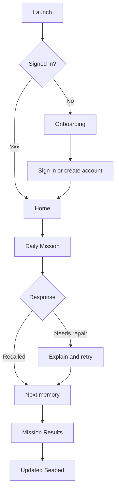
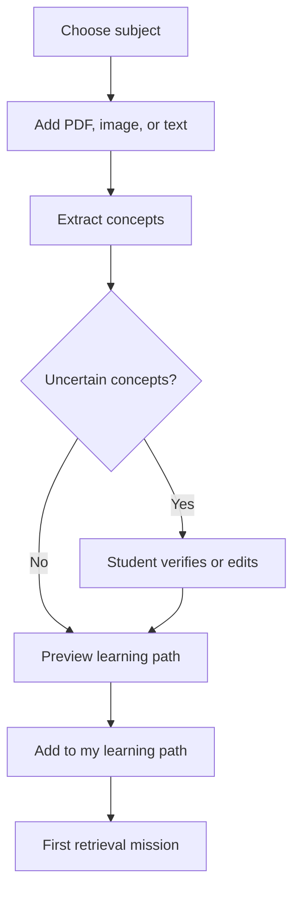

# Memora UI/UX Design Specification

**Document 3 of 6**  
**Status:** Canonical implementation brief  
**Audience:** Product designers, UI engineers, QA engineers, and AI coding agents  
**Applies to:** Student-facing mobile MVP  
**Source set:** `../screens/` and `../references/ui-ux-audit/`  
**Related documents:** `./Memora_PRD.md` and `./Memora_TRD.md` (with matching DOCX copies in this directory)  

## 1. Purpose and authority

This document turns the current Memora screen designs and visual audit into an implementation-ready UI/UX contract. It describes what the student sees, what each control does, how screens connect, and how the interface behaves in normal, empty, loading, success, error, and accessibility states.

This document is authoritative for student-facing presentation and interaction. The PRD remains authoritative for product scope and business rules. The TRD remains authoritative for architecture, data models, APIs, and infrastructure. If a visual source image conflicts with this specification, follow this specification and treat the image as visual reference only.

The source screens use an English-learning course as sample content. That content is not the MVP domain. The MVP is student-first and initially supports Sri Lankan GCE A/L Physics. Preserve the layout intent, not the sample subject matter.

### 1.1 Implementation language

The keywords **must**, **should**, and **may** are deliberate:

- **Must** means required for the MVP.
- **Should** means expected unless a documented constraint prevents it.
- **May** means optional enhancement.

Every requirement with a `UIX-` identifier is testable. AI coding agents should cite the relevant identifier in implementation notes, tests, and pull-request descriptions.

### 1.2 Product experience in one sentence

Memora turns a student's own learning material into short, supportive retrieval missions that keep a personal coral reef healthy over time.

### 1.3 Source files and path rules

All paths in this document are relative to `docs/specifications/`:

- Production screen references: `../screens/`
- Earlier UI/UX audit images: `../references/ui-ux-audit/`
- PRD, TRD, and this specification: the current directory (`./`)

Before implementing or visually reviewing a screen, an agent must open the corresponding PNG listed in Section 15. This specification is the authority for behavior, accessibility, responsive rules, and revised UX. The PNG is the authority for the retained visual composition. When they conflict, follow this specification and document the visual deviation.

## 2. Experience principles

### UIX-001 - The next useful action is obvious

Each primary screen must have one visually dominant action. On Home this is **Start Daily Mission** or **Continue Daily Mission**. On Learning it is the current mission node. On Material it is **Add to my learning path** after a valid source exists.

### UIX-002 - Progress feels alive, not judgmental

Use reef growth, healthy color, gentle motion, and Mora's guidance to show progress. Do not use red failure banners, broken-heart imagery, loss of permanent rewards, public ranking, or shame-based copy.

### UIX-003 - Retrieval is the core interaction

The interface should lead students from Home to a short Daily Mission with minimal choice overhead. Upload, statistics, and profile management are supporting flows.

### UIX-004 - Errors are recoverable

An incorrect response is a **Weak memory found** state. It must immediately offer a concise explanation and a repair attempt. The interface must never label the student as wrong, weak, behind, or failing.

### UIX-005 - Essential meaning never depends on color alone

Correctness, selection, reef state, progress, and validation must combine color with text, iconography, shape, or position.

### UIX-006 - The ocean metaphor stays understandable

The seabed is one continuous personal environment. Each subject is one coral reef. Temporary reef health represents memory maintenance; permanent decorations represent earned progress. Mora explains metaphorical states in plain language whenever ambiguity is possible.

### UIX-007 - Minors receive ethical engagement patterns

No infinite scroll, loot-box mechanics, countdown pressure, public leaderboards, streak-loss threats, manipulative notifications, or false urgency. Reminders must be optional and time-respectful.

## 3. Information architecture

The persistent student navigation has exactly four destinations:

| Destination | Purpose | Default landing content |
| --- | --- | --- |
| Home | Today's next useful action | Daily Mission card and current reef summary |
| Learning | Subjects, learning paths, and source material | Current subject path |
| Progress | Personal seabed and learning history | Full seabed with subject reefs |
| Profile | Account, preferences, and accessibility | Profile summary and settings |

### UIX-008 - Navigation visibility

The bottom navigation must appear on Home, Learning, Progress, and Profile. It must not appear during onboarding, authentication, an active mission, a repair attempt, or a modal/bottom sheet that requires a decision.

### UIX-009 - Active destination

Exactly one bottom-navigation item must be active, and it must match the visible destination. The current source screens incorrectly show Home as active on some quiz and statistics screens; do not copy that behavior.

### UIX-010 - Back and exit behavior

Every non-root screen must expose a visible Back control or a platform-native back behavior with the same result. An active mission must expose **Pause and exit** in an overflow or close menu. Exiting preserves answered questions and returns the student to the originating screen.

## 4. Visual system

### 4.1 Brand character

The interface is calm, optimistic, aquatic, and academically credible. Rounded geometry and ocean color create warmth; dark ink text and disciplined spacing keep it usable. Mora is a guide, not a prize dispenser or blocking mascot.

### 4.2 Color tokens

Use semantic tokens in code. Hex values below are the light-theme defaults, not names to hard-code in components.

| Token | Value | Use |
| --- | --- | --- |
| `color.brand.primary` | `#00AFFF` | Primary brand fill, icons, selected accents |
| `color.brand.aqua` | `#00E1FF` | Gradient end and non-text highlight |
| `color.brand.blue` | `#067FFF` | Secondary brand accent |
| `color.surface.canvas` | `#FFFFFF` | App canvas |
| `color.surface.soft` | `#F5F9FF` | Low-emphasis sections and cards |
| `color.surface.ocean` | `#DDEEFF` | Hero panels, navigation surface, question card |
| `color.surface.mint` | `#F6FBEF` | Supportive success background |
| `color.surface.lilac` | `#EFE7EF` | Optional decorative surface |
| `color.text.primary` | `#1D2228` | Main text and text on cyan |
| `color.text.secondary` | `#203F59` | Supporting text |
| `color.text.muted` | `#566B7D` | Secondary metadata when contrast passes |
| `color.border.default` | `#AACFEA` | Visible borders and dividers |
| `color.control.rest` | `#86BBE7` | Unselected answer fill; never sole boundary cue |
| `color.control.selected` | `#D4F2FF` | Selected control background with dark outline |
| `color.feedback.positive` | `#137A4B` | Positive text/icon, paired with light surface |
| `color.feedback.attention` | `#9A5B00` | Repair/attention text, paired with light amber surface |
| `color.feedback.critical` | `#B42318` | Destructive/error text only, never ordinary recall feedback |
| `color.focus` | `#067FFF` | Keyboard focus ring |

### UIX-011 - Contrast rules

- Dark ink (`#1D2228`) on ocean (`#DDEEFF`) and cyan (`#00AFFF`) is permitted.
- Cyan text on ocean is not permitted for essential information because the contrast is insufficient.
- Pale blue controls must have a visible outline, label, or elevation against pale blue surfaces.
- Normal text must meet WCAG 2.2 AA contrast of 4.5:1; large text and essential graphical objects must meet 3:1.
- Feedback colors must be verified in the final rendered theme, not assumed from token names.

### 4.3 Typography

Use Exo for brand expression, headings, controls, navigation, and compact metrics. Use Inter for explanations, longer body copy, input text, and detailed learning content. If either font fails to load, use a system sans-serif fallback without layout breakage.

| Style | Font | Weight | Size / line height | Use |
| --- | --- | --- | --- | --- |
| Display | Exo | 700 | 32 / 40 | Rare hero statement |
| Page title | Exo | 600 | 28 / 36 | Root screen titles |
| Section title | Exo | 600 | 22 / 30 | Major card/section heading |
| Question | Exo | 600 | 24 / 32 | Mission prompt |
| Card title | Exo | 600 | 17 / 24 | Cards and subject titles |
| Button | Exo | 600 | 16 / 24 | Primary/secondary actions |
| Body | Inter | 400 | 16 / 25 | Explanations and general copy |
| Body strong | Inter | 600 | 16 / 24 | Labels and emphasized body |
| Metadata | Inter | 500 | 14 / 20 | Counts, dates, helper text |
| Navigation | Exo | 600 | 13 / 20 | Bottom navigation labels |

### UIX-012 - Text scaling

The interface must remain usable at 200% text scaling. Text may wrap; it must not be clipped or overlap controls. Content cards must grow vertically. Fixed-height containers are prohibited where they contain user-visible text.

### 4.4 Shape, elevation, and imagery

- Primary cards: 24 px radius.
- Controls and compact cards: 16 px radius.
- Chips and status labels: fully rounded or 12 px radius.
- Default shadow: subtle, diffuse, and used only to distinguish an interactive surface from the canvas.
- Use a one-pixel border where elevation alone would be ambiguous.
- Learning images must have meaningful alternative text when instructional. Decorative reef and Mora images must be hidden from assistive technology unless they communicate a state not stated in text.

## 5. Layout and responsive behavior

### UIX-013 - Mobile baseline

The source screens use a 402 px-wide canvas. Implement fluidly for 320-480 px mobile widths. Use 16 px outer gutters below 360 px and 24 px gutters at 360 px and above. The content column may not exceed 560 px on mobile/tablet single-column layouts.

### UIX-014 - Spacing scale

Use the scale 4, 8, 12, 16, 24, 32, and 48 px. New 3, 5, 7, 10, 20, or 28 px spacing values require a documented component-specific reason.

### UIX-015 - Safe areas

Top headers and bottom navigation must include device safe-area insets. Scroll content must receive enough bottom padding that the final action or line of content is not obscured by navigation, a sticky action, or the software keyboard.

### UIX-016 - Large screens

At 768 px and wider, center the experience within a 720 px content frame. The seabed may expand to a wider canvas, but learning content and forms remain readable rather than stretching edge to edge. Do not invent a desktop sidebar for the MVP.

### UIX-017 - Answer layout

Answer options may use two columns only when every option fits on one line at the active text scale and each target remains at least 48 px tall. Otherwise use a single column. The source 2 x 2 grid is a reference, not a fixed rule.

## 6. Global components

### 6.1 App header

The root header contains the Memora brand, optional profile/avatar affordance, menu/settings affordance, and current streak status. It must not reserve mascot space. Mora may overlap a hero card only when the overlap cannot hide text or controls.

### UIX-018 - Header variants

- **Root:** brand, compact profile/menu access, streak status.
- **Detail:** Back, page title, optional contextual action.
- **Mission:** Close/Pause, memories protected progress, optional timer control.
- **Authentication/onboarding:** no app header.

### 6.2 Bottom navigation

Use icon plus visible label for all four items. Each target must be at least 48 x 48 px. The active item uses a filled soft-cyan container, stronger icon, and text label; inactive items still retain labels.

### 6.3 Buttons

| Variant | Appearance | Use |
| --- | --- | --- |
| Primary | Cyan-to-aqua gradient or solid primary; dark label | One dominant action per region |
| Secondary | White/soft surface, dark label, visible blue border | Alternative action |
| Tertiary | Text and optional icon; no container | Low-emphasis action such as Skip question |
| Destructive | White/light critical surface, critical text and icon | Sign out, remove source, delete account |

Buttons must be at least 48 px high and must expose default, pressed, focused, disabled, and loading states. A loading button keeps its label or adds a nearby status so the outcome remains understandable.

### 6.4 Cards

Cards group one concept and should not contain competing primary actions. A card may be selectable or navigational, but not both without distinct controls and labels. Progress cards include a title, plain-language status, numeric detail, and optional bar.

### 6.5 Inputs and selectors

Inputs must have persistent labels above the field. Placeholder text is an example, not the only label. Validation appears below the field with an icon and clear correction. Dropdowns must not cover their trigger and should avoid covering the primary action; use a bottom sheet on narrow screens when more than four options exist.

### 6.6 Toasts, banners, dialogs, and sheets

- Toast: non-critical confirmation, visible long enough to read, announced politely.
- Inline banner: recoverable page-level information or error.
- Dialog: short, blocking confirmation such as abandoning an unsubmitted source.
- Bottom sheet: contextual detail such as reef status or subject selection.

Dialogs and sheets must trap focus, expose a clear title, support Escape/back dismissal where safe, and return focus to the invoking control.

### 6.7 Mora

Mora supports, explains, and celebrates. Mora must not obscure content, change the position of an answer after selection, or appear as the only carrier of essential meaning.

Mora states:

| State | Expression/pose | Use |
| --- | --- | --- |
| Guide | Calm, pointing or holding notebook | Onboarding, first-use help |
| Encourage | Warm smile, compact placement | Home, weak memory repair |
| Celebrate | Brief joyful motion | Mission completion and permanent reward |
| Think | Neutral/curious | Loading or concept verification |
| Rest | Small, non-dominant | Empty or paused state |

## 7. Core interaction states

### UIX-019 - Loading

Use skeletons for page-level card loading and an inline progress status for a specific operation. After 10 seconds, show plain-language status and an option to leave or retry. Never show a mascot animation indefinitely without text.

### UIX-020 - Empty

Every empty state must explain what is absent, why it matters, and the next action. Example: **No learning material yet. Add notes or a PDF to build your first Physics learning path.**

### UIX-021 - Error

Errors must identify the affected action and offer recovery. Preserve user input when retrying. Do not use raw server messages or codes in the primary copy.

### UIX-022 - Offline

Show a persistent but non-blocking offline banner. If the current mission is available locally, allow it to continue and explain that results will sync later. Actions requiring a connection must be disabled with a reason.

### UIX-023 - Motion

Default transitions are 180-300 ms with ease-out timing. Reef growth and celebration may last up to 800 ms but must not delay access to the next action. Respect reduced-motion settings by replacing movement with fades or instant state changes.

## 8. Core flows

### 8.1 First-use flow

1. Splash identifies Memora briefly.
2. Three onboarding screens explain fading memory, timely retrieval, and growing a reef through small reviews.
3. The final screen offers **Create account** as primary and **I already have an account** as secondary.
4. Authentication returns to Home.
5. If no subject exists, Home presents **Add learning material** and a short explanation of the first mission.

### 8.2 Daily Mission flow

1. Home shows the mission size, estimated duration, subject, and due-memory count.
2. Starting the mission hides bottom navigation.
3. Each memory presents one prompt and an appropriate response control.
4. Submission reveals explicit recall feedback.
5. A weak memory receives a short explanation and one repair attempt.
6. Completion shows memories protected, repaired, XP earned, streak status, and reef growth.
7. The student may view the updated reef or return Home.

### 8.3 Source-to-learning-path flow

Uploading a file does not earn XP. XP is awarded for completed retrieval work.

## 9. Screen specifications

### 9.1 Splash

**Source reference:** `../screens/Onboarding.png` and `../screens/Memora - Spaced repetition.png`.

**Purpose:** Brand recognition while the app restores session state.

**Required content:** Memora wordmark and a compact Mora illustration on a quiet ocean surface. Do not show navigation, buttons, or a fake loading percentage.

**Behavior:** Display only for the time required to initialize, with a maximum intentional hold of 800 ms. Route signed-in students to Home and signed-out students to onboarding/authentication.

### 9.2 Onboarding 1 - Memory fades

**Source reference:** `../screens/Onboarding-1.png`.

- Eyebrow: **1 of 3**.
- Title: **New memories can fade.**
- Body: **That is normal. A quick review at the right time helps bring them back.**
- Visual: simple illustrative forgetting curve, explicitly labeled as an illustration rather than measured personal data.
- Primary: **Next**.
- Secondary: **Skip onboarding**.

### 9.3 Onboarding 2 - Timely return

**Source reference:** `../screens/Onboarding-3.png` (despite the filename, the visual is step 2).

- Eyebrow: **2 of 3**.
- Title: **Come back before it fades.**
- Body: **Memora schedules short reviews when they can help most. Timing adapts as you learn.**
- Visual: a simple return interval; avoid promising a universal 24-hour rule.
- Primary: **Next**.
- Secondary: **Skip onboarding**.

### 9.4 Onboarding 3 - Grow the reef

The current source set does not provide a clear third screen; implement this specification rather than duplicating step 2.

- Eyebrow: **3 of 3**.
- Title: **Small reviews grow something lasting.**
- Body: **Protect memories to help each subject reef recover and thrive. What you earn stays yours.**
- Visual: one continuous seabed with a neutral new reef becoming healthy; Mora points to the change.
- Primary: **Create account**.
- Secondary: **I already have an account**.

### 9.5 Sign in

**Source reference:** `../screens/Memora login.png`.

Order: Back if entered from onboarding, title, supporting copy, email/username, password, **Forgot password?**, primary **Sign in**, divider, **Continue with Google**, **Create an account**.

Validation must be inline and preserve entered values. Password visibility has an accessible toggle. The Google action must say **Continue with Google**, not **Sign up with Google**.

### 9.6 Create account

**Source reference:** `../screens/Memora login-1.png` is incomplete and should not be treated as a full layout.

Order: title **Welcome to Memora**, name, email, password, confirm password, age/consent step if required by product policy, primary **Create account**, **Continue with Google**, **I already have an account**.

Password requirements are visible before submission. Errors appear at the affected field and in a focusable summary when several fields fail.

### 9.7 Home

**Source reference:** `../screens/Home.png`.

Home answers three questions in this order: What should I do now? What will it help? What else can I explore?

1. Root header with brand, menu/profile access, and streak.
2. Daily Mission hero.
3. Current reef health summary.
4. Subject carousel/list if more than one subject exists.
5. Optional recent achievement; never more prominent than the mission.

**Daily Mission hero content:** subject, **Daily Mission**, due-memory count, estimated time, supportive outcome, progress if already started, and primary action. Example: **8 memories | about 5 min** and **Protect today's Physics memories**.

**Primary action states:**

- Not started: **Start Daily Mission**.
- In progress: **Continue Daily Mission** plus completed count.
- Complete: **View today's results**; the card becomes visually settled, not urgent.
- No due memories: **Quick practice** may be offered, but the interface must state that today's reef care is complete.
- No learning path: **Add learning material**.

Do not retain the generic **Continue your journey** hierarchy from the source. The Daily Mission is the dominant object.

### 9.8 Learning

**Source reference:** `../screens/Everyday English learning path.png`.

The page title is the subject name, with a subject switcher when multiple subjects exist. Show learning-path progress and a vertically scrollable path of missions/concepts.

Node states:

| State | Visual | Interaction |
| --- | --- | --- |
| Completed | Check icon, calm filled node | Opens summary and optional practice |
| Current | Play/arrow icon, strongest emphasis | Starts or continues mission |
| Available | Outlined node | Opens preview and start action |
| Locked | Lock icon plus reason | Non-startable; explains prerequisite |
| Needs review | Refresh/memory icon and text | Opens due retrieval mission |

The path may curve decoratively, but semantic reading and focus order must remain top-to-bottom. Gift or XP milestones are labeled in text and never require guessing from an icon.

**Secondary action:** **Add material** in the page header or after the final available node.

### 9.9 Add learning material

**Source reference:** `../screens/Material.png` and `../screens/Material-1.png`.

Order:

1. Detail header with Back and **Add learning material**.
2. Subject selector.
3. Source options: PDF/document, image/camera, or pasted text.
4. Uploaded source list with status, size/pages where known, and remove action.
5. Privacy/supporting note.
6. Primary **Extract concepts**.

Replace **Click here to upload** with **Upload material**. Do not promise to create only a quiz. The result is a learning path backed by retrieval missions.

**File states:** queued, uploading, processing, ready, unsupported, failed, and remove-confirmation. A failed file retains a retry control. Multiple sources are allowed only if supported by the PRD; otherwise clearly state the one-source limit.

### 9.10 Verify concepts

This required screen is absent from the current visual source set.

After extraction, present concepts grouped by confidence:

- High-confidence concepts are selected by default.
- Uncertain concepts are visibly marked **Check this** and must be reviewed.
- The student can edit a concept title, remove irrelevant content, and merge obvious duplicates.
- Source excerpts may be shown for context but must not overwhelm the concept list.

Primary action: **Preview learning path**. Disabled only when no valid concept remains; explain why.

### 9.11 Learning-path preview

Show subject, source name, concept count, estimated first-mission duration, and a short list of the first concepts. Primary action: **Add to my learning path**. Secondary: **Edit concepts**.

Successful addition routes to a ready state with **Start first mission**. It does not award XP until retrieval work is completed.

### 9.12 Active mission

**Source reference:** `../screens/quiz.png` and `../screens/quiz - correct-1.png`.

The source quiz layout becomes a focused mission shell:

1. Mission header: Pause/exit, **Memories protected X of Y**, and optional timer control.
2. Thin progress indicator with a text equivalent.
3. Prompt.
4. Optional instructional image.
5. Response controls.
6. Tertiary **Skip question**.
7. Sticky primary **Check answer**.

Bottom navigation and the root header are hidden. Mora may appear in the header margin at first use, then stays small or absent during recall.

### UIX-024 - Timer

The timer is hidden by default. Students may enable elapsed time in mission settings. Never show a countdown. Timer visibility cannot change scoring, XP, or reef health.

### UIX-025 - Response controls

- Single choice: radio semantics; selecting does not submit.
- Multiple choice: checkbox semantics and explicit instruction.
- Typed answer: persistent label and tolerant validation where product rules allow.
- Image prompt: meaningful alt text when the image is necessary; a text alternative must make the task possible.

### 9.13 Recalled state

**Source reference:** `../screens/quiz - correct.png` contains visual feedback but the current hierarchy is inconsistent.

After submission, keep the prompt and selected response stable. Add an inline feedback panel:

- Heading: **Memory protected**.
- Icon: check/shield.
- One-sentence reinforcement or explanation.
- Optional **Explain answer**.
- Primary **Next memory**.

Do not rely on making the selected option green. The action button remains the standard primary style rather than becoming a correctness color.

### 9.14 Weak memory and repair

**Source reference:** `../screens/quiz incorrect.png`.

When the response is not recalled:

- Heading: **Weak memory found**.
- Body: **Let's repair it now.**
- Mark the student's choice and the expected answer with icons and text, not color alone.
- Show a concise explanation connected to the source material.
- Primary **Try a repair question**.
- Secondary **Explain answer** when a longer explanation exists.

The repair question should test the same concept using a simpler cue, different wording, or recognition step. After the repair attempt, continue the mission. Do not loop indefinitely.

### 9.15 Explanation

**Source reference:** `../screens/quiz explain.png`.

The current screen mixes a sample answer with whole-quiz scores. Replace it with a focused concept explanation during a mission:

1. Back/close to return to feedback.
2. Concept/question title.
3. Correct answer.
4. Short explanation in plain language.
5. Source reference or excerpt when available.
6. Optional **Show another example**.
7. Primary **Continue mission**.

Mission score and accuracy do not belong on this screen.

### 9.16 Mission results

This screen replaces the source's ambiguous post-quiz sequence.

Required summary:

- Title: **Mission complete**.
- **6 memories protected**.
- **2 memories repaired**.
- **+52 XP**.
- **Streak secured** or a truthful alternative.
- **Reef growth +8%** with a before/after state description.
- One short Mora message.

Primary: **See my reef**. Secondary: **Back to Home**. If no reef-health change occurs, say **Your reef is steady** rather than showing zero as failure.

### 9.17 Progress - Seabed

**Source reference:** `../screens/stats.png` supplies metric ideas, but its technical graph is not the main student experience.

Progress opens on a continuous seabed containing one reef per subject. The student can pan or scroll through reefs while a stable header summarizes personal progress. There is no public comparison.

Each reef label includes subject, health state, next review timing in plain language, and a progress detail. A new/untested reef is neutral, not unhealthy.

Reef states:

| State | Meaning | Visual direction | Suggested copy |
| --- | --- | --- | --- |
| New | Not enough retrieval evidence | Neutral young coral, calm water | New reef - complete the first mission |
| Thriving | Reviews are current and recall is strong | Rich color and gentle life | Thriving |
| Healthy | Generally current with some due soon | Balanced color | Healthy |
| Needs Care | Due memories are accumulating | Muted areas, no decay horror | Needs care - a short mission can help |
| Dormant | No recent learning activity | Calm, subdued reef | Dormant - return when you are ready |

### UIX-026 - Temporary and permanent progress

Reef health may improve or soften based on review recency. Earned XP, decorations, and cosmetics are permanent and must never be removed because the student misses a day.

### 9.18 Reef detail sheet

Selecting a reef opens a bottom sheet with:

1. Subject and health state.
2. Plain-language explanation.
3. Memories due now.
4. Current learning-path progress.
5. Last mission and next suggested review.
6. Permanent decorations earned.
7. Primary **Start review mission** when due.
8. Secondary **Open learning path**.

The source audit suggests a 390 x 384 sheet; implement content-driven height with a maximum of 90% viewport and internal scrolling where required.

### 9.19 Learning statistics

Statistics are a secondary view reached from Progress, not a replacement for the seabed.

Retain understandable metrics from `../screens/stats.png`: weekly XP, missions completed, memories protected/repaired, active days, and subject progress. Replace the dense network graph with either a labeled concept list or an optional educator/advanced view outside the MVP.

The forgetting curve must be labeled as an illustration or model estimate, never as measured brain activity. Every chart needs a text summary and accessible data representation.

### 9.20 Profile

**Source reference:** `../screens/Profile.png`.

Order: profile identity, edit profile, current streak, subjects/learning paths, preferences, accessibility, notification settings, privacy/support, sign out.

Course progress cards may be retained but use MVP terminology: subject and learning path. Profile must not duplicate the entire Progress dashboard.

### 9.21 Notifications

**Source reference:** `../screens/Notification.png`.

The source shows a compact **you got a new quiz** message. Replace the copy and make notifications contextual:

- **Your Physics Daily Mission is ready. About 5 minutes.**
- **A few memories are ready for care. Review when it suits you.**
- **Your reef decoration is ready to place.**

Notification preferences include on/off, preferred time, quiet hours, and streak reminders. Default wording must not imply irreversible loss. Tapping a mission notification deep-links to its preview, not directly into a timed question.

### 9.22 Accessibility and mission settings

Expose text size support, reduced motion, sound/haptics, timer visibility, high-contrast option if offered, and notification controls. Settings changes apply immediately where safe and persist across sessions.

## 10. Gamification contract

### 10.1 XP

XP is the only reward currency in the MVP. Award it for completed learning actions, especially retrieval and repair. Do not award XP for opening the app, uploading material, or changing settings.

XP presentation must state the action that earned it. A total may appear on Progress/Profile; a transient increment appears on mission results.

The MVP `xp-v1` presentation uses 6 XP for each protected or repaired memory,
plus 10 XP when a mission contains at least one such outcome. A comeback
completion adds 6 XP. Normal and comeback missions are capped at 46 and 52 XP.
Skipped or unresolved items earn no item XP, and a mission with no protected or
repaired memory earns zero. The UI explains the total by learning outcome and
does not expose correctness multipliers, boosts or competitive ranking.

### 10.2 Streak

A streak day is secured by completing the Daily Mission. The experience supports one grace day within a rolling seven-day period and a supportive comeback mission after a break, as defined in the PRD.

Streak copy:

- Secured: **Streak secured - 7 days**.
- Grace available: **Rest day used. Your streak is safe.**
- Return after break: **Welcome back. Start a comeback mission.**

Avoid **Don't lose your streak**, flashing urgency, or countdowns to midnight.

### 10.3 Reef growth

Reef changes reflect memory-care activity and are reversible. The interface must always pair visual state with text. A subject with no evidence is **New**, not **Needs Care**.

### 10.4 Permanent rewards

Decorations and cosmetics may unlock at clear XP milestones. They remain owned permanently and can be placed or changed without affecting learning outcomes. Avoid randomized rewards.

## 11. Content and UX writing

### 11.1 Terminology

| Use | Meaning | Avoid when this meaning is intended |
| --- | --- | --- |
| Subject | Physics or another area of study | Course when referring to the subject itself |
| Learning path | Ordered concepts/missions within a subject | Course progress |
| Mission | Short retrieval session | Quiz as a generic term |
| Question | One prompt inside a mission | Challenge when it adds pressure |
| Memory | A concept/knowledge item being retrieved | Brain node |
| Weak memory | A concept not recalled in this attempt | Wrong, failed, bad |
| Reef health | Temporary memory-care state | Score |
| XP | Permanent earned progress currency | Coins, gems, energy |

### 11.2 Voice

- Supportive and direct: **Let's repair it now.**
- Specific: **8 memories | about 5 min.**
- Honest about uncertainty: **Timing adapts as you learn.**
- Brief on action surfaces.
- Never infantilizing, shaming, or falsely scientific.

### 11.3 Required source-copy corrections

| Current/source copy | Required copy |
| --- | --- |
| Quizes | Quizzes, only where a true quiz is meant |
| Welcome back (create account) | Welcome to Memora |
| Sign up with Google (sign-in page) | Continue with Google |
| Click here to upload | Upload material |
| skip | Skip question |
| Explain | Explain answer |
| Next (to statistics/results) | View results or View learning statistics |
| Create quiz | Add to my learning path |
| Keep your memories alive | Care for each reef to keep your knowledge strong |
| you got a new quiz. | Your Daily Mission is ready. |

## 12. Accessibility requirements

### UIX-027 - Standard

The MVP must target WCAG 2.2 AA for supported platforms.

### UIX-028 - Keyboard and switch access

All interactive elements must be reachable and operable in logical order. Focus must be visible. Decorative path curves and reef objects must not disrupt focus order.

### UIX-029 - Screen-reader structure

Each screen has one primary heading. Cards and groups have labels. Progress indicators expose current and total values. Answer feedback is announced after submission without unexpectedly moving focus.

### UIX-030 - Touch targets

Targets should be at least 48 x 48 px and must never be smaller than the WCAG 24 x 24 px minimum. Closely spaced icon controls need sufficient separation.

### UIX-031 - Images and charts

Instructional images require equivalent text. Decorative Mora/reef art uses empty alternative text. Charts provide a concise text summary and access to the underlying values.

### UIX-032 - Cognitive accessibility

Use consistent labels and action placement. Avoid simultaneous animations, unnecessary timers, dense network visualizations, and unexplained scientific diagrams. Break long tasks into short steps with progress.

## 13. State matrix

| Area | Empty | Loading | Success | Recoverable error | Blocking error |
| --- | --- | --- | --- | --- | --- |
| Home | No learning path; add material | Mission/reef skeleton | Mission ready/complete | Retry mission summary | Account/session recovery |
| Learning | No subject path | Path skeleton | Current node available | Could not refresh; use cached path | Source removed/unavailable |
| Material | No source selected | Upload/extraction progress | Concepts ready | Retry failed file/extraction | Unsupported/encrypted source |
| Mission | No due memories | Next question loading | Recalled/mission complete | Offline sync pending | Mission data unavailable |
| Progress | New neutral reef | Seabed skeleton | Reef updated | Cached view with retry | Progress cannot load |
| Profile | No optional fields | Profile skeleton | Settings saved | Inline validation/retry | Re-authentication required |

### UIX-033 - Persistence through interruption

Mission answers, upload selections, concept edits, and form input should survive ordinary interruptions when technically safe. The user must be warned before any action that discards unsaved work.

## 14. Component acceptance checklist

Every reusable component must be verified for:

- Default, pressed, focused, disabled, loading, error, and selected states as applicable.
- 320 px width and 200% text scale.
- Light-theme color contrast.
- Screen-reader name, role, state, and value.
- Keyboard/switch focus order.
- Reduced-motion behavior.
- Long labels and localized strings.
- Offline or delayed response where relevant.

## 15. Screen-to-source mapping

This table tells an implementation agent what to retain from the supplied screens and what to change.

| Source file | Retain | Change or replace |
| --- | --- | --- |
| `../screens/Onboarding.png` | Mora-led brand warmth | Use only as splash; no forced delay |
| `../screens/Onboarding-1.png` | Curve illustration and careful qualifier | Updated copy and accessibility summary |
| `../screens/Onboarding-3.png` | Return-timing concept | Treat as step 2; remove universal 24-hour implication |
| `../screens/Memora login.png` | Clear single-column form | Persistent labels; Continue with Google; error states |
| `../screens/Memora login-1.png` | Account-creation intent | Rebuild complete screen; Welcome to Memora |
| `../screens/Home.png` | Card language, subject context, ocean styling | Make Daily Mission dominant; add reef summary |
| `../screens/Everyday English learning path.png` | Winding learning path, current/completed/locked nodes | Physics sample content; accessible linear order; clearer node states |
| `../screens/Material.png` | Subject + source workflow | Upload material; extraction and concept verification; no XP on upload |
| `../screens/Material-1.png` | Subject-selection concept | Use accessible sheet/menu that does not obscure key content |
| `../screens/quiz.png` | Large prompt, optional image, clear answers | Hide root nav/header; optional timer; responsive answers |
| `../screens/quiz - correct.png` | Inline feedback intent | Explicit Memory protected panel; stable primary button style |
| `../screens/quiz incorrect.png` | Immediate feedback intent | Weak memory repair flow; non-color meaning; no punitive red action |
| `../screens/quiz - correct-1.png` | Text-only question option | Remove excessive empty image space; content-driven layout |
| `../screens/quiz explain.png` | Explanation card | Remove whole-quiz metrics; source-linked concept explanation |
| `../screens/stats.png` | Weekly activity and readable summary metrics | Progress opens on seabed; remove technical graph from main view; correct nav |
| `../screens/Profile.png` | Identity and progress-card structure | Add preferences/accessibility; avoid duplicating Progress |
| `../screens/Mobile navigation.png` | Four labeled destinations | Correct active state; safe areas; 48 px targets |
| `../screens/Notification.png` | Mora notification personality | Daily Mission wording, optional reminders, no urgency |
| `../screens/mora3 2.png` | Mascot visual asset | Use only in defined Mora states and non-blocking placements |

## 16. Delivery and QA definition of done

A screen is not implementation-complete until:

1. Its entry and exit paths match this specification.
2. Its primary action is unambiguous.
3. Empty, loading, success, recoverable-error, offline, and disabled states are implemented where applicable.
4. The bottom navigation visibility and active state are correct.
5. The screen is usable at 320 px width and 200% text scale.
6. Touch, keyboard/switch, and screen-reader behavior are verified.
7. Essential information is not conveyed by color or mascot art alone.
8. Copy uses the terminology in this document.
9. Motion respects reduced-motion settings.
10. Any deviation is documented against a `UIX-` requirement and approved through the product/design process.

## 17. Agent handoff prompt

When asking an AI coding agent to implement Memora UI, provide this document plus the relevant source images and use the following instruction:

> Implement the requested Memora screen using `docs/specifications/Memora_UI_UX_Design_Specification.md` as the behavioral and accessibility authority. Open the matching source PNG under `docs/screens/` before coding. Use the PNG as the visual-composition reference. If they conflict, follow the specification. Cite the `UIX-` requirements you implemented, include all applicable states, and do not invent product rules that belong in the PRD or architecture that belongs in the TRD.

## 18. Known design work still open

The specification resolves the implementation-blocking gaps in the supplied visual audit. These items remain design-production tasks rather than missing behavior:

- Final illustrations for the third onboarding screen and the five reef states.
- Final Physics learning content and instructional imagery.
- Exact permanent decoration set and XP milestone art.
- Dark-theme palette, if dark mode enters scope.
- Platform-specific authentication/consent details governed by policy and the PRD.

